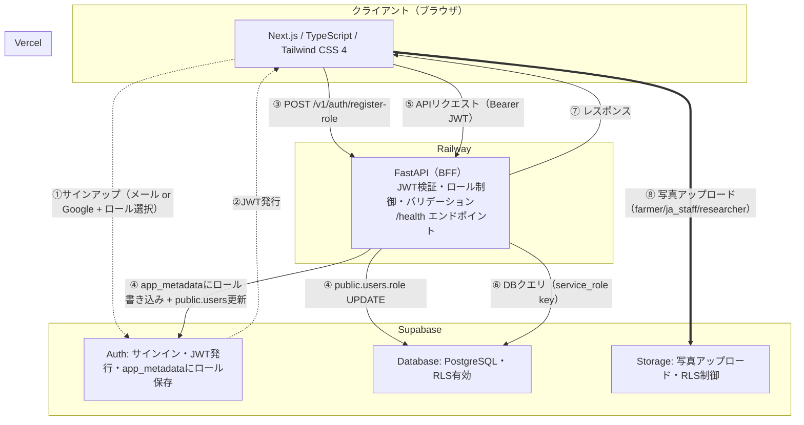

# Farmille v1 アーキテクチャ

## 1. 構成サービス一覧

| レイヤー | サービス | 役割 |
|----------|----------|------|
| フロントエンド | Next.js + TypeScript + Tailwind CSS 4 | ユーザーが操作する画面 |
| フロントデプロイ | Vercel | フロントのホスティング・自動デプロイ |
| バックエンド（BFF） | FastAPI / Python 3.12 | JWT検証・ロール制御・ビジネスロジック・DBアクセス |
| バックデプロイ | Railway | FastAPIのホスティング |
| DB | Supabase (PostgreSQL) | データの永続化 |
| 認証 | Supabase Auth | ユーザー認証・JWT発行 |
| ストレージ | Supabase Storage | レビュー写真の保存 |

## 2. アーキテクチャ図



## 3. データフロー

### 原則

**全てのビジネスロジックはFastAPIを経由する。**
フロントエンドがSupabaseに直接アクセスするのは以下の2つのみ：

| 例外 | 理由 |
|------|------|
| 認証（Supabase Auth） | 認証はSupabaseの責務。JWTをFastAPIで再発行する必要がない |
| 写真アップロード（Supabase Storage） | バイナリデータをFastAPI経由にすると不必要に複雑。RLSで制御 |

### 登録フロー（ロール付与）

1. ユーザーが登録フォームで4ロールからラジオボタンで選択
2. Supabase Auth でアカウント作成（メール or Google認証）
3. DBトリガー `handle_new_user` が発火 → `public.users` に `role='unassigned'` で自動INSERT
4. Next.js が FastAPI に `POST /v1/auth/register-role { role: "farmer" }` を送信
5. FastAPI が JWT検証（本人確認） → `app_metadata.role` に書き込み（Admin権限） → `public.users.role` を UPDATE
6. 以降のリクエストで `app_metadata.role` を参照して権限判定

**なぜ `app_metadata` か：**
`user_metadata` はユーザー自身がクライアントから書き換え可能なため、権限情報の保存には使用しない。`app_metadata` はAdmin権限でしか書き込めず、改ざんリスクがない。

**なぜ `public.users.role` も維持するか：**
RLSの正（Single Source of Truth）は `app_metadata.role`。ただしSQLクエリでのロール別集計やStorage RLSでの参照用に `public.users.role` も同期して保持する。`POST /v1/auth/register-role` が両方を一括で更新し整合性を保証する。

### 通常のAPIフロー

リクエスト処理パイプライン：
1. JWT検証（署名確認・有効期限チェック）
2. ロール判定（`app_metadata.role` を参照）
3. リクエストバリデーション（Pydanticで型・必須フィールド検証）
4. ビジネスロジック実行
5. Supabase DBクエリ（RLSが第二防御として機能）
6. レスポンス返却

### 認証フロー（例外）

ブラウザが Supabase Auth に直接アクセスし、JWTを取得する。`@supabase/ssr` がCookieベースのセッション管理を担う。以降のAPIリクエストにJWTを付与する。

### 写真アップロードフロー（例外）

ブラウザから Supabase Storage に直接アップロードする。RLSポリシーにより `app_metadata.role IN ('farmer', 'ja_staff', 'researcher')` のユーザーのみアップロード可能。

## 4. 4ロール権限体系

4ロールはそれぞれ独立した権限を持つ。将来的にJA用ダッシュボード等の固有機能が追加される前提。

| ロール | レビュー投稿 | 写真UP | 資材登録 | 将来の固有機能 |
|--------|:-----------:|:------:|:-------:|:------------:|
| `farmer` | ✅ | ✅ | — | — |
| `ja_staff` | ✅ | ✅ | — | JAダッシュボード |
| `researcher` | ✅ | ✅ | — | — |
| `maker` | — | — | ✅ | 資材管理ダッシュボード |
| `unassigned` | — | — | — | オンボーディング画面のみ |

## 5. セキュリティ設計

### 二重防御の構造

| FastAPI（第一防御） | Supabase RLS（第二防御） |
|---|---|
| JWTの有効性確認 | テーブル行レベルのアクセス制御 |
| ロール判定（`app_metadata.role`） | FastAPIのバグによるデータ漏洩防止 |
| ビジネスロジック検証 | 直接APIアクセスへの対策 |

### Supabase Storageポリシー

| 操作 | 条件 |
|------|------|
| アップロード | `app_metadata.role IN ('farmer', 'ja_staff', 'researcher')` |
| 閲覧 | 全員（`anon` + `authenticated`） |
| ファイルサイズ上限 | 5MB（バケット設定） |
| 許可する拡張子 | `.jpg` `.jpeg` `.png` `.webp` |

## 6. APIエンドポイント一覧

ベースURL: `/v1`

### 認証

| メソッド | パス | 説明 |
|----------|------|------|
| `POST` | `/v1/auth/register-role` | ロール付与（オンボーディング） |

### 資材

| メソッド | パス | 説明 | 権限 |
|----------|------|------|------|
| `GET` | `/v1/products` | 資材一覧（検索・フィルタ） | 全員 |
| `GET` | `/v1/products/:id` | 資材詳細 | 全員 |
| `POST` | `/v1/products` | 資材登録 | maker |
| `PUT` | `/v1/products/:id` | 資材編集 | 自社のみ |
| `DELETE` | `/v1/products/:id` | 資材削除 | 自社のみ |

### レビュー

| メソッド | パス | 説明 | 権限 |
|----------|------|------|------|
| `GET` | `/v1/products/:id/reviews` | レビュー一覧 | 全員 |
| `POST` | `/v1/products/:id/reviews` | レビュー投稿 | farmer/ja_staff/researcher |
| `PUT` | `/v1/reviews/:id` | レビュー編集 | 投稿者本人 |
| `DELETE` | `/v1/reviews/:id` | レビュー削除 | 投稿者本人 |

### ユーザー

| メソッド | パス | 説明 | 権限 |
|----------|------|------|------|
| `GET` | `/v1/users/me` | 自分のプロフィール | ログイン済み |
| `PUT` | `/v1/users/me` | プロフィール更新 | ログイン済み |

### システム

| メソッド | パス | 説明 |
|----------|------|------|
| `GET` | `/health` | ヘルスチェック（keep-alive用） |

## 7. ローカル開発環境

### Supabase プロジェクト分離

| 環境 | プロジェクト | 用途 |
|------|-------------|------|
| ローカル開発 | `farmille-dev` | 開発・テスト用 |
| 本番 | `farmille-prod` | 実ユーザーのデータ |

Supabase無料枠は2プロジェクトまで対応可能。追加コストゼロ。

### 起動手順

```bash
git clone https://github.com/farmille/farmille.git
cd farmille
cp frontend/.env.example frontend/.env.local
cp backend/.env.example backend/.env
make setup
make dev
```

## 8. 可用性設計

### Railwayコールドスタート対策

RailwayのHobbyプランはアイドル時にコンテナがスリープする。Vercel Cronで5分ごとに `/health` を叩き、コンテナをウォーム状態に保つ。

## 9. コスト試算

| サービス | プラン | 月額 |
|----------|--------|------|
| Vercel | 無料 | $0 |
| Railway | Hobby | $5〜 |
| Supabase (dev) | 無料 | $0 |
| Supabase (prod) | 無料〜Pro | $0〜$25 |
| **合計** | | **$5〜$30/月** |
