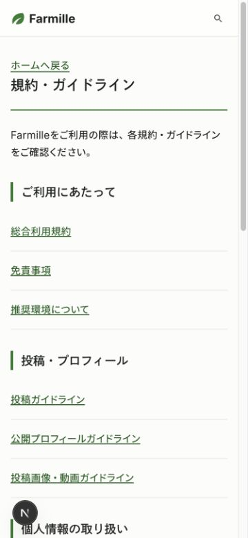
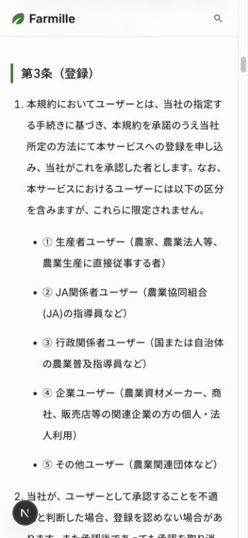
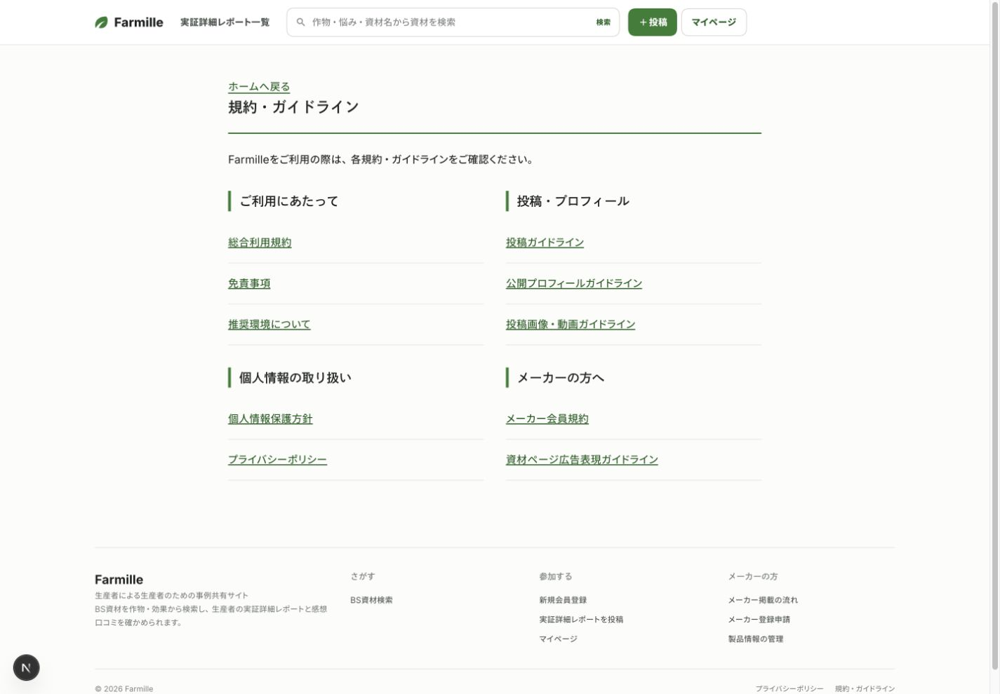
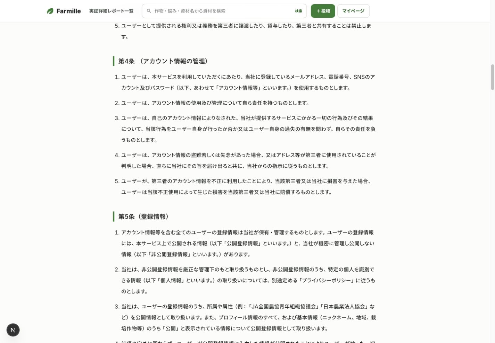

# 規約集の掲載

## 原稿と画面

[Farmille 規約・ガイドライン 第1版](https://docs.google.com/document/d/1WBws2Rt7coIv89GjEGaO-9IPjgkIcec3MF2ikvy6OFI/edit)の10文書を収録する。原稿本文の法的内容は変更しない。

規約集は `/legal`、詳細は `/legal/terms`、`posting`、`profile`、`media`、`data-protection`、`privacy`、`disclaimer`、`manufacturer`、`advertising`、`environment` に配置する。

h1はページ名と緑の下線、h2は条文・項目名と緑の左罫線、h3は本文内の小見出しに使う。見出しの表示は `src/app/legal/styles.ts` に集約する。目次は各項目へのページ内リンクにする。

フッター、一般登録の同意欄、メーカー申請、資材詳細の注意書きから遷移できる。登録フォーム内のリンクは別タブで開く。

## 検証

- 成功：数字の半角化とMarkdown書式を除いた原稿51,170文字が、取り込み後の本文と一致した。
- 成功：10文書のHTTP 200、存在しない規約URLのHTTP 404を確認した。
- 成功：375pxと1440pxの実ブラウザーで、10文書とも横はみ出しがなかった。各文書のh1は1つで、目次のリンク先はすべて存在した。
- 成功：目次から第3条への移動と、本文の入れ子の箇条書きの表示を確認した。
- 成功：lint、format、型検査、ビルド、Vitest 184件。通常実行のDB統合テスト2件はスキップし、資材検索の1件は隔離DBで別途成功した。

## 原稿の確認事項

総合利用規約第9条は投稿の権利を会社へ帰属・譲渡させる記載で、投稿ガイドライン第13項などは投稿者に著作権が残る記載になっている。ユーザーの指定により、双方とも原文を掲載する。法的整合性の確認は未実施。

プライバシーポリシーの動作環境リンクは原稿内の外部サイトを維持する。YouTube利用規約のURLは原稿にない。これらの原稿内容も変更していない。

実証詳細レポート全文のログイン要件は、別途実装・検証する。

## 実画面

