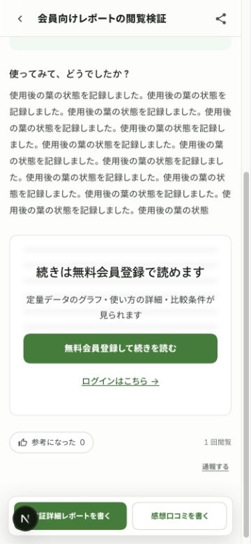
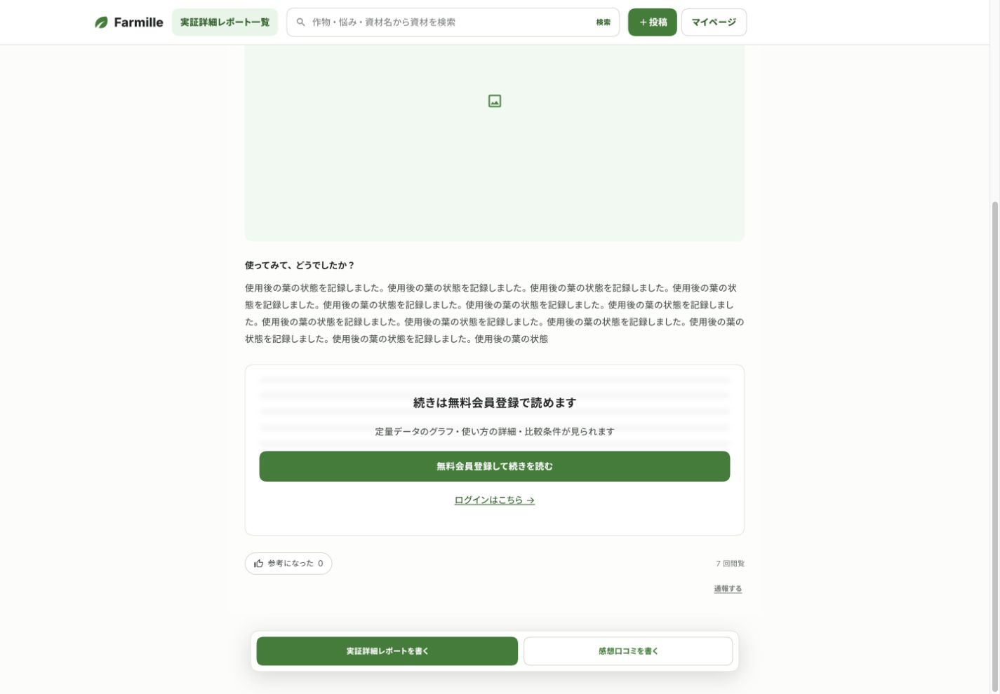
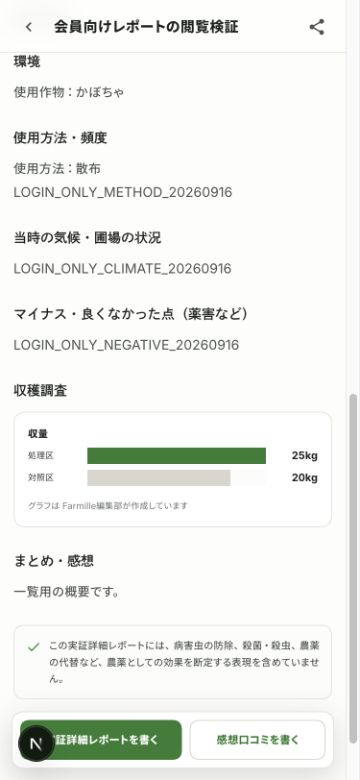
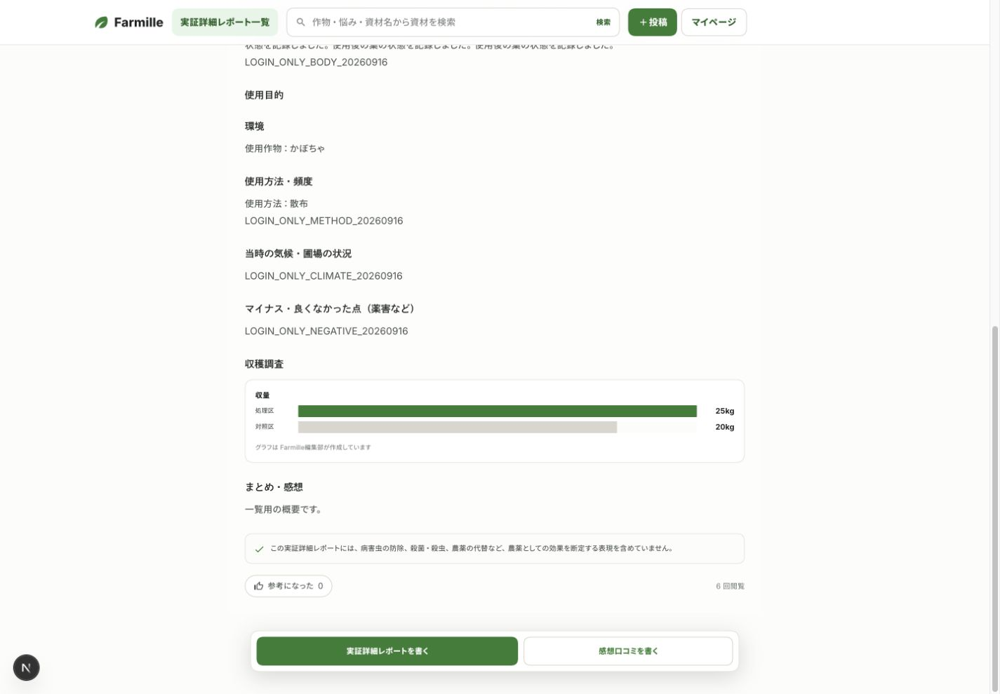

# 実証詳細レポートの会員限定閲覧

## 変更点

未ログインではタイトル・投稿者・作物・目的タグ・先頭画像・使用感の冒頭200文字を表示する。本文の続きは、装飾用のぼかしと無料会員登録・ログインの案内に置き換える。デモの会員登録案内と同じ構成で、定量データ・使い方・比較条件がログイン後に読めることを説明する。

未ログインのHTMLに全文を含めない。DBの原本・施用条件・定量データは匿名では読めず、公開一覧には要約120文字までを返す。一般・メーカー・運営はログイン後に全文を読める。

ログインと新規登録の戻り先を保持する。確認メールは同一オリジンの安全なパスだけを引き継ぐ。規約本文は指定原稿を維持する。

## ローカル検証

- 成功：pgTAP 14件。匿名での原本・施用条件・定量データの遮断、先頭画像の限定、公開範囲、各アカウント種別の全文取得を確認した。
- 成功：Vitest 187件。通常実行でスキップしたDB統合テスト2件も、隔離DBで別途実行して成功した。
- 成功：375pxと1440pxで会員登録案内と全文を確認した。横はみ出しはなかった。
- 成功：案内からログインし、元のレポートへ戻って本文・施用条件・グラフを表示した。ログアウト後は再び案内を表示した。
- 成功：未ログインのHTTP応答に、本文・気候・施用条件の検証用文字列が含まれなかった。
- 成功：認証メールに同一サイトの戻り先を載せるテストと、外部サイト・ログイン画面への戻り先を除外するテスト。
- 未実行：本番での新規会員登録メール送信。実在アカウントへのテスト送信は行っていない。

## 実画面

