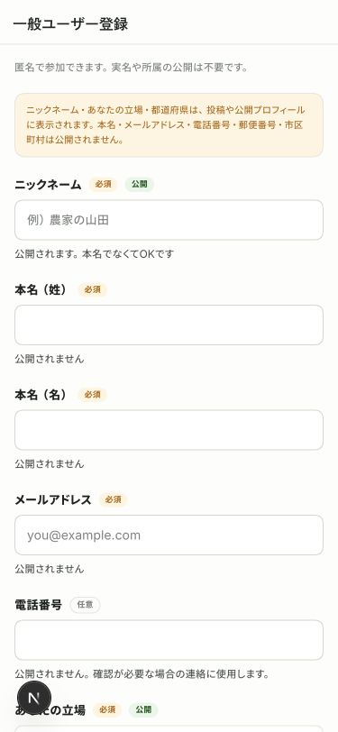
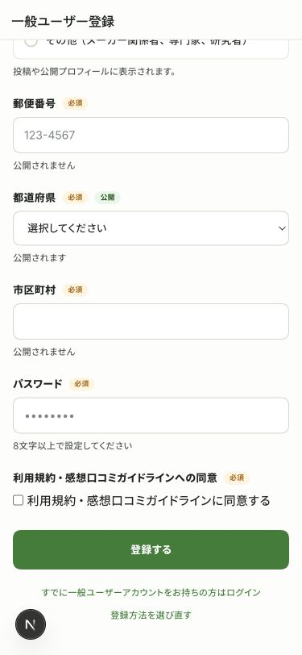
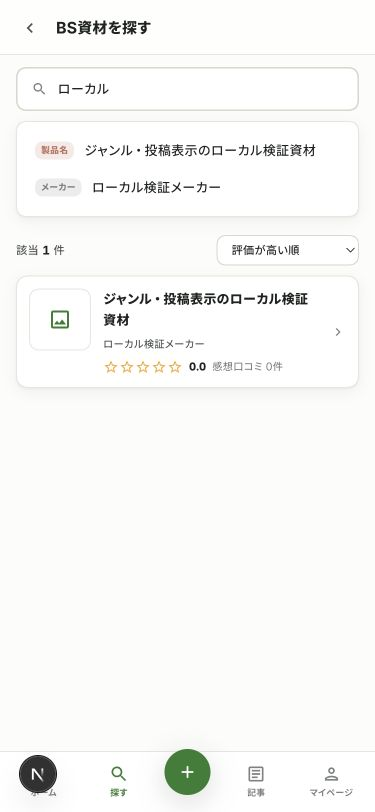
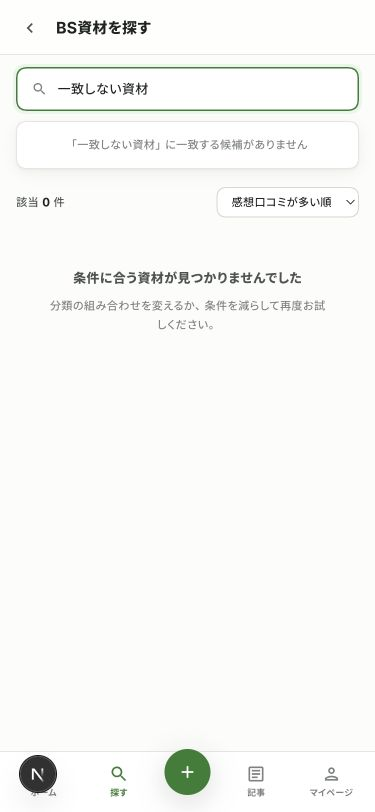
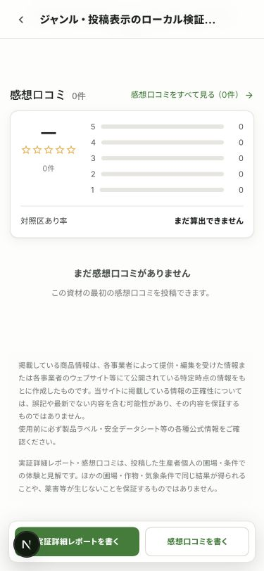
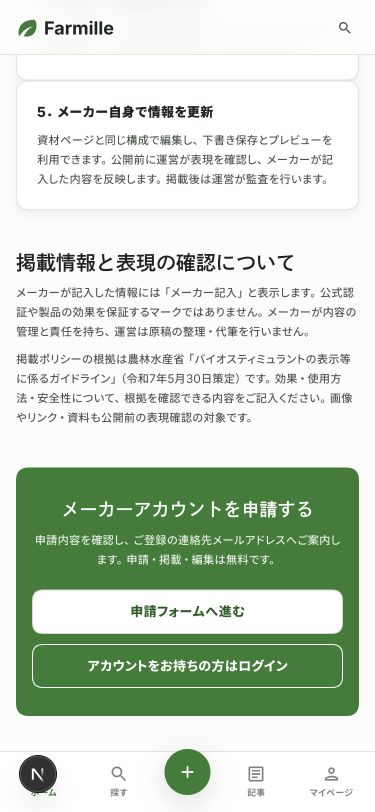
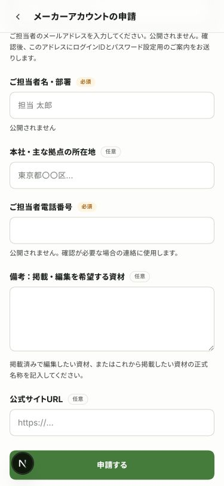

# 9月15日の画面レビューへの対応

対象：[Slackのレビューと返信](https://farmillehq.slack.com/archives/C0C19R6DLJX/p1789435252314779?thread_ts=1789424708.393579&cid=C0C19R6DLJX)

## 対応した項目

- 一般登録のニックネーム・立場・都道府県に「公開」を表示し、フォーム冒頭でも公開範囲を案内する。各項目の公開範囲そのものは変更しない。
- 一般登録のアイコン画像案内欄を削除する。登録後のプロフィール編集での画像設定は維持する。
- メーカー申請のメール欄に、担当者のメールアドレスを入力することを明記する。
- メーカー案内の情報記入者の表記を「メーカー記入」に揃える。
- 検索入力を資材一覧と件数に反映する。入力後300ミリ秒で更新し、日本語変換中は更新しない。資材名・メーカー名・分類名・作物の別名を検索し、候補表示の8件制限は検索結果に適用しない。キーワード内はOR、選択済みの条件とはANDで絞る。並び替えでもキーワードを維持する。
- 資材ページ下部に、掲載情報の正確性・公式情報の確認・投稿結果の適用範囲に関する指定の注意書きを掲載する。

## 検証

2026年9月16日に、ローカルのコードと検証用Supabaseで実施した。本番は未反映。スキーマ変更はない。

- 成功：lint、format、TypeScript、ビルド、差分の空白チェック。
- 成功：Vitest 187件。通常実行でスキップするDB統合テスト2件も、ローカルDB接続で別途実行して成功した。
- 成功：実DBで資材名とメーカー名のOR検索・重複排除・該当なし・資材ジャンル8分類の絞り込みを確認した。
- 成功：in-app Browserの375px表示で、文字入力だけで1件→0件→1件になること、入力フォーカスの維持、並び替え、候補の確定、検索結果から資材詳細への遷移を操作した。
- 成功：登録フォームの公開表示、アイコン案内欄の削除、メーカー申請のメール説明、メーカー案内の表記、資材詳細末尾の注意書きを実画面で確認した。
- 依存監査：high 2件は既存のimage-sizeパッチ対象で、`check:security-patches`が成功した。low 3件・moderate 12件は残っている。依存更新は行っていない。

## 残件

- 規約本文・規約一覧・同意欄からのリンク・資材注意書き末尾の規約リンクは、[規約集の掲載](20260916-legal-pages.md)で対応した。
- 郵便番号からの住所補完。住所データの取得とフォーム連携が必要となる。
- 投稿フォームとデモの詳細項目の照合、マイページの自己紹介・リンク編集。今回の修正対象には含めていない。
- 登録後の4ステップ案は、Slackでは提案として記載されているため実装していない。
- 本番での検証とリリースは未実施。

## 実画面

### 一般登録の公開範囲

### 入力検索

### 資材ページの注意書き

### メーカー向けの説明

