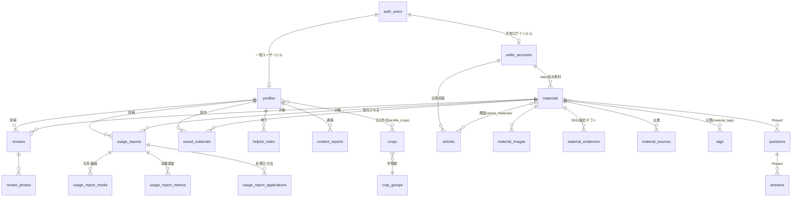

# 01 ドメインモデル・DB 設計

前提：[00-overview.md](00-overview.md) の決定事項 D1・D3・D5〜D8。DB は Supabase（PostgreSQL）。migration は SQL（`supabase/migrations/` を全面リセットして v2 系を新規作成）。適用済み migration の編集は禁止、修正は常に新規ファイルで行う。

## 1. オブジェクトの全体像

OOUI の結論を踏襲する：**資材＝情報の倉庫（全関係のハブ）**。供給は2系統（一般ユーザーの投稿＝匿名の本音、出品者の一次情報＝実名の公式）で、分類・検索層だけは Farmille が所有して中立性を構造に埋め込む。

- メインオブジェクト：資材・レビュー・使用レポート・ユーザー（一般／出品者）
- コレクション：検討リスト（保存した資材）・参考になったの一覧
- 分類：タグ（Farmille 所有）・作物マスタ
- Phase 2 スキーマ先行：質問・回答
- レビューと使用レポートは**別テーブル**（作成フォーム・表示・状態管理がまるごと違うため。OOUI の判断どおり）

## 2. ER 図

## 3. テーブル定義（v1 全テーブル）

型・制約の詳細は migration 実装タスクで確定するが、カラム構成は以下を正とする。全テーブル共通：`id uuid PK default gen_random_uuid()`、`created_at`、`updated_at`。

### アカウント

**profiles**（一般ユーザー。auth.users と 1:1）
- `user_id` uuid PK・FK → auth.users
- `handle` text NOT NULL UNIQUE（ハンドルネーム）
- `prefecture_code` smallint NOT NULL（JIS X 0401。1〜47）
- `prefecture_public` boolean NOT NULL default true
- `standpoint` text NOT NULL CHECK IN ('farmer','ja','maker_related','expert','other')（立場。**内部専用・どの画面にも表示しない**。信頼スコア・ステマ検知用）
- `avatar_url` text NULL
- `bio` text NULL（一言プロフィール）
- `cultivation_styles` text[] NULL（栽培形態。'施設園芸' 等の選択式）
- `affiliation` text NULL（所属団体名。D5：プロフィール画面のみ表示・投稿カードには出さない）
- `website_url` text NULL・`sns_url` text NULL（モック準拠の外部リンク・任意）
- 主な作目は `profile_crops`（user_id, crop_id）の m2m

**seller_accounts**（出品者組織。申請〜承認〜運用を1テーブルの status で管理）
- `auth_user_id` uuid NULL UNIQUE FK → auth.users（承認時に共有ログインを発行して紐付け。申請中は NULL）
- `official_name` text NOT NULL（正式名称）
- `seller_type` text NOT NULL CHECK IN ('maker','ja','farm_corp','expert','other')
- `login_id` text NOT NULL UNIQUE（表示・管理用。認証は合成メール方式 → §5）
- `contact_email` text NOT NULL（内部のみ）・`contact_name` text NOT NULL（内部のみ）
- `location` text NOT NULL（本社・主な拠点）
- `region_scope` text NOT NULL（主な地域：'全国'・地方ブロック名・都道府県名）
- `website_url` text NULL・`logo_url` text NULL・`profile_text` text NULL
- `status` text NOT NULL CHECK IN ('applied','approved','rejected','suspended') default 'applied'
- `approved_at` timestamptz NULL・`invite_code` text NULL（招待経由の登録動線用）

### 資材（2層構造）

**materials**
- 分類・検索層（**Farmille のみ編集可**）：`name`・`manufacturer_name` text NOT NULL（マスタ由来の表示名。未 claim でも表示する）・`product_type` ・`jbsa_class`（効果分類）・`sales_status`・タグ（material_tags）
- 一次情報層（**claim 済み出品者が編集可**）：`description`（紹介文）・`general_use`（一般用途）・`ingredients`（主成分）・`mechanism`（作用機序）・`usage_text`（使い方）・`price_range`・`official_url`・`catalog_url`
- 状態：`seller_id` uuid NULL FK → seller_accounts（NULL＝未 claim。値あり＝claim 済み）
- 集計（トリガーまたはビューで自動）：`review_count`・`avg_rating`・`control_plot_ratio`（対照区ありレビュー率＝確からしさ指標）
- 層の割当はこの表が正（監査 A-8 の解決）。「メーカー確認済み」バッジ＝ `seller_id IS NOT NULL`

**material_images**（`material_id`・`url`・`image_type`・`sort_order`）
**material_evidences**（`material_id`・`evidence_type` CHECK IN ('sds','paper','trial','leaflet')・`title`・`file_url` または `external_url`・`meta`。一次情報層＝出品者編集可）
**material_sources**（出典。現行 product_sources の思想を引き継ぐ：`material_id`・`source_url`・`source_type`・`note`）
**material_edit_requests**（分類変更申請：`material_id`・`seller_id`・`request_text`・`status` CHECK IN ('open','done','declined')）

### 分類（Farmille 所有）

**tags**（`name`・`category` CHECK IN ('crop','concern','effect','condition','type')。メーカー名・製品名の検索候補はタグではなく materials/seller_accounts から動的生成）
**material_tags**（material_id, tag_id）
**crop_groups**・**crops**（`name`・`group_id`・`aliases` text[]。モックの12群・約45作物＋表記ゆれ辞書を初期シードにする）

### 投稿

**reviews**
- `material_id`・`author_user_id`（FK → profiles）
- `rating` smallint NOT NULL CHECK 1〜5・`body` text NOT NULL
- `crop_id` uuid NOT NULL FK → crops（作目。必須）
- `has_control_plot` boolean NULL（対照区の有無。任意・確からしさ指標の分子）
- `purchase_channel` text NULL CHECK IN ('ja','home_center','ec','direct','other')（D7：内部専用・非表示）
- `pesticide_ack` boolean NOT NULL（農薬的効果を断定しない旨の同意。**false なら投稿不可**）
- `is_provided_sample` boolean NOT NULL default false（提供品フラグ。景表法対応の先行実装。v1 の UI では常に false）
- `status` text NOT NULL CHECK IN ('published','hidden') default 'published'（通報対応の非公開化用。即時公開が原則）
- **review_photos**（`review_id`・`url`・`caption`・`sort_order`）

**usage_reports**（編集局ワークフローあり → §6）
- `material_id`・`author_user_id`・`title` text NULL（編集局が整える）
- `status` text NOT NULL CHECK IN ('draft','pending','published','declined') default 'draft'
- `crop_id` NOT NULL・`purpose_tags` text[]（使用目的）・`purpose_note`
- 環境：`prefecture_code`・`field_name`・`variety`・`planting_date`・`cultivation_type`（露地／施設等）・`cultivation_tags` text[]・`growth_stage`・`climate_note`
- 内容：`observed_change` text NOT NULL・`negative_note`・`summary` text NOT NULL
- `pesticide_ack` boolean NOT NULL・`is_provided_sample` boolean default false
- `editor_note` text NULL（編集局用・内部）・`published_at`
- **usage_report_applications**（処理日・使用方法：`applied_on` date・`method`・`detail`）
- **usage_report_media**（`media_type` CHECK IN ('photo','video')・`url`・`caption`・`placement`・`sort_order`）
- **usage_report_metrics**（収穫調査の生数値を正規化保存：`metric_name`・`treated_value` numeric・`untreated_value` numeric・`unit`。グラフは表示時に生成し、画像化した編集部グラフは media に置く）

### コレクション・リアクション

**saved_materials**（検討リスト：`user_id`・`material_id`・UNIQUE(user_id, material_id)）
**helpful_votes**（`user_id`・`target_type` CHECK IN ('review','usage_report','article','answer')・`target_id` uuid・UNIQUE(user_id, target_type, target_id)。個票で持つ＝信頼スコアの材料。集計はビュー／トリガー）
**view_events**（`target_type`・`target_id`・`viewer_user_id` NULL・`created_at`。追記専用。表示用の閲覧数は日次集計。使用レポート・記事のみ表示、レビューカードには出さない）

### 記事（Phase 1）

**articles**（`seller_id` NOT NULL・`title`・`body`（Markdown）・`hero_image_url`・`status` CHECK IN ('draft','published')・`published_at`）
**article_materials**（article_id, material_id。他社資材への紐づけ可）

### 通報・運営

**content_reports**（`reporter_user_id`・`target_type` CHECK IN ('review','usage_report','article','profile','material')・`target_id`・`reason` text・`status` CHECK IN ('open','resolved','dismissed')・`resolved_by`・`resolved_at`）

### Phase 2 スキーマ先行（migration には含めるが UI なし）

**questions**（`material_id`・`author_user_id`・`body`）
**answers**（`question_id`・`author_user_id` NULL・`author_seller_id` NULL・`body`。CHECK で著者はどちらか一方のみ。`author_seller_id` があれば公式回答。要件定義どおり一般ユーザーの回答も可）

## 4. 認証設計

- **一般ユーザー**：Supabase Auth のメール＋パスワード。`app_metadata.account_type = 'general'`
- **出品者**：ログイン ID＋パスワード（メールと分離・MVP は組織共有）。実装は**合成メール方式**：`{login_id}@sellers.farmille.internal` を auth.users の email にして通常のパスワード認証を使う。ログイン画面は ID 入力を受け、Next.js のサーバー側（`src/server/`）で合成メールに変換する（クライアントに合成メールを露出しない）。`app_metadata.account_type = 'seller'`、`app_metadata.seller_id = <seller_accounts.id>`。承認処理（admin）がこの auth ユーザーを Admin API で作成する
- **admin**：`app_metadata.account_type = 'admin'`。**AAL2（MFA/TOTP）必須**を旧設計から踏襲。admin 系画面・API は role と AAL の両方を検証する
- Phase 2 のメンバー個別ログインに備え、権限判定はすべて `seller_id` 経由で行う（auth_user_id 直接参照を業務テーブルに持ち込まない）

## 5. RLS 設計（第二防御）

方針：JWT の `app_metadata` を直接参照し、テーブル JOIN での判定は避ける。D6 により公開読み取りが基本。

| テーブル | SELECT | INSERT | UPDATE / DELETE |
|---|---|---|---|
| profiles | 全員（standpoint・非公開 prefecture は**公開ビュー経由**でのみ読ませ、実テーブルは本人のみ） | 本人 | 本人 |
| seller_accounts | 全員（approved のみ。contact_* は内部カラムのため公開ビューから除外） | anon（申請） | 本人（approved 後の profile 系カラムのみ）・admin |
| materials | 全員 | admin | admin（全カラム）・claim 済み seller（一次情報層カラムのみ。**カラム分離はビュー＋RPC または列単位トリガーで強制**） |
| material_evidences / images / sources | 全員 | seller（自社資材のみ）・admin | 同左 |
| tags / crops | 全員 | admin | admin |
| reviews | 全員（published のみ） | account_type='general' かつ本人 | 本人・admin |
| usage_reports | published は全員・draft/pending は本人と admin | general かつ本人 | 本人（draft のみ）・admin（全状態） |
| saved_materials / helpful_votes | 本人 | 本人（要ログイン） | 本人 |
| articles | 全員（published のみ） | seller 本人 | seller 本人・admin |
| content_reports | admin と本人 | ログイン済み全員 | admin |
| questions / answers | 全員 | （Phase 2 で解放。v1 は INSERT ポリシーなし＝deny） | 同左 |

- 公開プロフィール・出品者ページは**ビュー（security invoker）で公開カラムだけを晒す**。「収集する情報と表示する情報の分離」（要件定義の設計思想）を DB 層で保証する
- 第一防御（Next.js のサーバー側・`src/server/`）はこの表と同じ判定をアプリ層でも行う。RLS はあくまで保険

## 6. 状態遷移

**資材 claim**：`未claim（seller_id NULL）` →（出品者が申し出・運営が確認＝admin 操作）→ `claim済み`。v1 の claim 成立処理は admin 画面から手動で行う（自動ハンドシェイクは作らない）

**使用レポート**：`draft`（本人編集可）→ 提出 → `pending`（編集局が調整。本人は閲覧のみ）→ `published` ／ `declined`。レビューは即時公開なので状態を持たない（`published`/`hidden` のみ）

**出品者アカウント**：`applied` →（審査）→ `approved`（共有ログイン発行）／ `rejected`。運用中の凍結は `suspended`

## 7. 信頼スコアのための初期フック（不可視・算出は Phase 2）

要件定義の調査結論（食べログ型の不可視影響度を初期から DB に仕込む）に対応する収集項目：

- `profiles.standpoint`（立場・非表示）・`profiles.created_at`（新規アカウントの票を効かせない判定用）
- `reviews.purchase_channel`・`reviews.has_control_plot`・`reviews.is_provided_sample`
- `helpful_votes` の個票（誰が押したか）・`view_events` の生ログ
- 算出式・重み付けは v1 では実装しない。集計はすべて生データから再計算可能な形で持つ

## 8. 資材マスタ移行（D1）

- 移行元：現行 `products`（294件）・`product_images`・`product_sources`・`product_application_recipes`・`maker_profiles.company_name`・`product_types`
- 移行先：`materials`（`manufacturer_name` ← maker_profiles.company_name。**seller_id は全件 NULL＝未 claim で開始**）・`material_images`・`material_sources`・タグ初期値（現行の crop/benefit 紐づけから変換）
- 施用レシピ（application_recipes）は `materials.usage_text` へ整形して集約（構造化テーブルとしては持ち越さない。将来必要になれば出典から再構築）
- 手順：旧スキーマの対象テーブルを CSV/JSON にエクスポート → 変換スクリプト（tools/migration/）→ 新スキーマへ INSERT → 件数・サンプル照合。旧テーブル群は移行検証完了後に DROP
- 現行の一次スクリプト（backend/scripts/excel_to_seed_sql.py ほか）はメーカー名正規化ロジックの参照実装として利用する
