# 01 ドメインモデル・DB 設計

前提：[00-overview.md](00-overview.md) の決定事項 D1・D3・D6〜D8・D15〜D17。DB は Supabase（PostgreSQL）。migration は SQL（`supabase/migrations/` を全面リセットして v2 系を新規作成）。適用済み migration の編集は禁止、修正は常に新規ファイルで行う。

## 1. オブジェクトの全体像

OOUI の結論を踏襲する：**資材＝情報の倉庫（全関係のハブ）**。供給は2系統（一般ユーザーの投稿＝匿名の本音、メーカーの一次情報＝実名の公式）で、分類・検索層だけは Farmille が所有して中立性を構造に埋め込む。

- メインオブジェクト：資材・レビュー・使用レポート・一般ユーザー・メーカー
- 付随する取引オブジェクト：資材変更申請（メーカーの追加・変更・掲載終了を運営が審査する履歴）
- コレクション：検討リスト（保存した資材）・参考になったの一覧
- 分類：効果・対象作物・材料・組成タイプ・製品タイプの各マスタと、悩み・栽培条件の検索タグ（Farmille 所有）
- Phase 2 スキーマ先行：質問・回答
- レビューと使用レポートは**別テーブル**（作成フォーム・表示・状態管理がまるごと違うため。OOUI の判断どおり）

## 2. ER 図

> 本節の図は概念設計時の簡略版。**実装準拠の完全な ER 図は [06-diagrams.md](06-diagrams.md) §1** を参照。

```mermaid
erDiagram
    auth_users ||--o| profiles : "一般ユーザー(1:1)"
    auth_users ||--o| seller_accounts : "共有ログイン(1:1)"

    profiles ||--o{ reviews : "投稿"
    profiles ||--o{ usage_reports : "投稿"
    profiles ||--o{ saved_materials : "保存"
    profiles ||--o{ helpful_votes : "押下"
    profiles ||--o{ content_reports : "通報"
    seller_accounts ||--o{ materials : "claim済み資材"
    seller_accounts ||--o{ material_change_requests : "提出"
    seller_accounts ||--o{ articles : "記事投稿"

    materials ||--o{ reviews : "対象"
    materials ||--o{ usage_reports : "対象"
    materials ||--o{ material_images : ""
    materials ||--o{ material_evidences : "SDS/論文/チラシ"
    materials ||--o{ material_sources : "出典"
    materials ||--o{ material_change_requests : "対象"
    materials }o--o{ effects : "効果(material_effects)"
    effects }o--|| effect_categories : "大分類"
    materials }o--o{ crops : "対象作物(material_crops)"
    materials }o--o{ search_tags : "発見語(material_search_tags)"
    materials }o--o{ ingredient_categories : "JBSA材料分類"
    materials }o--o{ ingredients : "個別材料"
    ingredients }o--|| ingredient_categories : "所属分類"
    materials }o--o{ product_types : "メーカー表記"
    materials }o--o| composition_types : "組成"
    materials }o--o{ articles : "関連(article_materials)"
    materials ||--o{ saved_materials : "保存される"
    materials ||--o{ questions : "Phase2"

    reviews ||--|| review_crops : "対象作目1件"
    crops ||--o{ review_crops : "選択される"
    reviews ||--o{ review_photos : ""
    usage_reports ||--o{ usage_report_media : "写真/動画"
    usage_reports ||--o{ usage_report_metrics : "収穫調査"
    usage_reports ||--o{ usage_report_applications : "処理日/方法"

    questions ||--o{ answers : "Phase2"
    crops }o--|| crop_groups : "作物群"
```

## 3. テーブル定義（v1 全テーブル）

型・制約の詳細は migration 実装タスクで確定するが、カラム構成は以下を正とする。全テーブル共通：`id uuid PK default gen_random_uuid()`、`created_at`、`updated_at`。

### アカウント

**profiles**（一般ユーザー。auth.users と 1:1）
- `user_id` uuid PK・FK → auth.users
- `handle` text NOT NULL UNIQUE（ハンドルネーム）
- `standpoint` text NOT NULL CHECK IN ('farmer','ja','expert','other')。登録時に必須で収集する内部属性。公開ビューや投稿には出さない
- `avatar_url` text NULL
- `created_at`・`updated_at`
- D16 により、地域・主な作目・栽培形態・所属・一言・外部リンクは保持しない。`profile_crops` も廃止する

**seller_accounts**（メーカーアカウント。申請〜承認〜運用を1テーブルの status で管理）
- `auth_user_id` uuid NULL UNIQUE FK → auth.users（承認時に共有ログインを発行して紐付け。申請中は NULL）
- `official_name` text NOT NULL（メーカーの正式名称）
- `login_id` text NOT NULL UNIQUE（表示・管理用。認証は合成メール方式 → §5）
- `contact_email` text NOT NULL（内部のみ）・`contact_name` text NOT NULL（内部のみ）
- `location` text NOT NULL（本社・主な拠点）
- `region_scope` text NOT NULL（主な地域：'全国'・地方ブロック名・都道府県名）
- `website_url` text NULL・`logo_url` text NULL・`profile_text` text NULL
- `status` text NOT NULL CHECK IN ('applied','approved','rejected','suspended') default 'applied'
- `approved_at` timestamptz NULL・`invite_code` text NULL（招待経由の登録動線用）

### 資材（2層構造）

**materials**
- 分類・検索層（**Farmille のみ編集可**）：`name`・`manufacturer_name` text NOT NULL（マスタ由来の表示名。未 claim でも表示する）・`sales_status`・`composition_type_id`、および効果・対象作物・材料分類・個別材料・製品タイプ・検索タグの各関連テーブル
- 一次情報層：`description`（紹介文）・`general_use`（一般用途）・`main_components`（主な成分の原文）・`mechanism`（作用機序）・`usage_text`（使い方）・`price_range`・`official_url`・`catalog_url`。メーカーは正本を直接更新せず、`material_change_requests` の承認を介して反映する
- 所有関係：`seller_id` uuid NULL FK → seller_accounts（NULL＝未 claim。値あり＝自社資材として申請可能）。claim だけでは確認済みにならない
- 掲載状態：`publication_status` CHECK IN ('published','archived') default 'published'・`archived_at`。掲載終了でもレビュー等を保持する。非公開資材は一般ユーザー・未ログインには詳細も表示せず、担当メーカーと運営だけが資材を参照する
- メーカーマスタ：`manufacturers.name` を自然キーとし、`materials.manufacturer_name` が外部参照する。`seller_accounts.manufacturer_name` はNULL許容・一意の外部参照で、承認時に設定する。承認処理は既存資材のclaimと同一トランザクションで反映する（09）
- 内容版：`content_revision` integer NOT NULL default 1。申請時点の版と承認時点の版を照合し、古い正本への変更を適用しない
- メーカー確認状態：`manufacturer_verified_at`・`manufacturer_verified_by_seller_id`・`manufacturer_verification_method` CHECK IN ('confirmed_existing','submitted_create','submitted_update')。公開マークは `manufacturer_verified_at IS NOT NULL` を条件とする
- 集計（トリガーまたはビューで自動）：`review_count`・`avg_rating`・`control_plot_ratio`（対照区ありレビュー率＝確からしさ指標）
- 層の割当と承認境界はこの表および [08-material-governance-ooui.md](08-material-governance-ooui.md) が正

**material_images**（`material_id`・`url`・`image_type`・`sort_order`）
**material_evidences**（`material_id`・`evidence_type` CHECK IN ('sds','paper','trial','leaflet')・`title`・`file_url` または `external_url`・`meta`。一次情報層＝メーカー編集可）
**material_sources**（出典。現行 product_sources の思想を引き継ぐ：`material_id`・`source_url`・`source_type`・`note`）

**material_change_requests**（メーカーの資材変更申請）
- `seller_id`・`material_id` NULL（追加申請では対象正本がまだ無い）・`result_material_id` NULL
- `change_type` CHECK IN ('create','update','archive')
- `status` CHECK IN ('pending','approved','rejected','cancelled')
- `reason`・`base_content_revision`・`manufacturer_confirmed_at`
- 審査：`reviewed_by`・`reviewed_at`・`review_note`
- 同一資材の `pending` は1件だけ。メーカー本人は pending を取消可能

**material_change_request_details**（追加・変更申請の資材スナップショット。資材の分類・一次情報カラムを正規化して保持）

**material_change_request_crops**・**material_change_request_effects**・**material_change_request_ingredient_categories**・**material_change_request_ingredients**・**material_change_request_product_types**・**material_change_request_search_tags**（提案された分類関係）

**material_change_request_evidences**（提案されたエビデンス全体。`source_evidence_id` で現行行との対応を保持し、追加・除外を差分表示できる）

### 分類（Farmille 所有）

分類は検索表示の都合で1つの汎用タグ表へ押し込まず、意味と更新単位ごとに正規化する。メーカー名・資材名の検索候補は `materials` から動的生成する。

- **effect_categories**（効果大分類：`name`・`sort_order`）
- **effects**（個別効果：`category_id`・`name`・`sort_order`）／**material_effects**（`material_id`・`effect_id`）。公開デモの4大分類・25個別効果を初期値とする
- **crop_groups**・**crops**（`name`・`group_id`・`aliases` text[]）／**material_crops**（`material_id`・`crop_id`・`source_name`・`sort_order`）。`source_name` はメーカー資料の記載名、作物群は `crops.group_id` から導出する
- **ingredient_categories**（JBSA材料分類）・**ingredients**（`category_id`・`name`）／**material_ingredient_categories**・**material_ingredients**。材料分類と個別材料を別の事実として保持する
- **composition_types**（単一系・混合系など）を `materials.composition_type_id` から参照する
- **product_types**／**material_product_types**。メーカー資料に複数の製品タイプが記載される場合を多対多で保持する
- **search_tags**（`category` CHECK IN ('concern','condition')）／**material_search_tags**。悩み・栽培条件など利用者の発見語だけを扱い、効果・作物・材料・製品タイプの正規化マスタと混在させない

検索は同一分類内を OR、分類間を AND とする。効果大分類と作物群は表示上のグループであり、資材との直接関連を重複保存しない。

### 投稿

**reviews**
- `material_id`・`author_user_id`（FK → profiles）
- `rating` smallint NOT NULL CHECK 1〜5・`body` text NOT NULL
- **review_crops**（`review_id` UNIQUE・`crop_id`）。作目は1件必須で、1レビューにつき1作目だけを保存する。親レビューと関連行は RPC で原子的に保存し、遅延制約トリガーでも0件を拒否する
- `has_control_plot` boolean NULL（対照区の有無。任意・確からしさ指標の分子）
- `purchase_channel` text NULL CHECK IN ('ja','home_center','ec','direct','other')（D7：内部専用・非表示）
- `pesticide_ack` boolean NOT NULL（農薬的効果を断定しない旨の同意。**false なら投稿不可**）
- `is_provided_sample` boolean NOT NULL default false（提供品フラグ。景表法対応の先行実装。v1 の UI では常に false）
- `status` text NOT NULL CHECK IN ('published','hidden') default 'published'（通報対応の非公開化用。即時公開が原則）
- **review_photos**（`review_id`・`url`・`caption`・`sort_order`）

**usage_reports**（編集局ワークフローあり → §6）
- `material_id`・`author_user_id`・`title` text NULL（編集局が整える）
- `status` text NOT NULL CHECK IN ('draft','pending','published','declined') default 'draft'
- `crop_id` NOT NULL・`purpose_tags` text[]（使用目的）・`purpose_note`
- 環境：`prefecture_code`・`field_name`・`variety`・`planting_date`・`cultivation_type`（露地／施設等）・`cultivation_tags` text[]・`growth_stage`・`climate_note`
- 内容：`observed_change` text NOT NULL・`negative_note`・`summary` text NOT NULL
- `pesticide_ack` boolean NOT NULL・`is_provided_sample` boolean default false
- `editor_note` text NULL（編集局用・内部）・`published_at`
- **usage_report_applications**（処理日・使用方法：`applied_on` date・`method`・`detail`）
- **usage_report_media**（`media_type` CHECK IN ('photo','video')・`url`・`caption`・`placement`・`sort_order`）
- **usage_report_metrics**（収穫調査の生数値を正規化保存：`metric_name`・`treated_value` numeric・`untreated_value` numeric・`unit`。グラフは表示時に生成し、画像化した編集部グラフは media に置く）

### コレクション・リアクション

**saved_materials**（検討リスト：`user_id`・`material_id`・UNIQUE(user_id, material_id)）
**helpful_votes**（`user_id`・`target_type` CHECK IN ('review','usage_report','article','answer')・`target_id` uuid・UNIQUE(user_id, target_type, target_id)。個票で持つ＝信頼スコアの材料。集計はビュー／トリガー）
**view_events**（`target_type`・`target_id`・`viewer_user_id` NULL・`created_at`。追記専用。表示用の閲覧数は日次集計。使用レポート・記事のみ表示、レビューカードには出さない）

### 記事（Phase 1）

**articles**（`seller_id` NOT NULL・`title`・`body`（Markdown）・`hero_image_url`・`status` CHECK IN ('draft','published')・`published_at`）
**article_materials**（article_id, material_id。他社資材への紐づけ可）

### 通報・運営

**content_reports**（`reporter_user_id`・`target_type` CHECK IN ('review','usage_report','article','profile','material')・`target_id`・`reason` text・`status` CHECK IN ('open','resolved','dismissed')・`resolved_by`・`resolved_at`）

### Phase 2 スキーマ先行（migration には含めるが UI なし）

**questions**（`material_id`・`author_user_id`・`body`）
**answers**（`question_id`・`author_user_id` NULL・`author_seller_id` NULL・`body`。CHECK で著者はどちらか一方のみ。`author_seller_id` があれば公式回答。要件定義どおり一般ユーザーの回答も可）

## 4. 認証設計

- **一般ユーザー**：Supabase Auth のメール＋パスワード。`app_metadata.account_type = 'general'`
- **メーカー**：ログイン ID＋パスワード（メールと分離・MVP は会社共有）。実装は**合成メール方式**：`{login_id}@sellers.farmille.internal` を auth.users の email にして通常のパスワード認証を使う。ログイン画面は ID 入力を受け、Next.js のサーバー側（`src/server/`）で合成メールに変換する（クライアントに合成メールを露出しない）。内部識別子として `app_metadata.account_type = 'seller'`、`app_metadata.seller_id = <seller_accounts.id>` を維持する。承認処理（admin）がこの auth ユーザーを Admin API で作成する
- **admin**：`app_metadata.account_type = 'admin'`。**AAL2（MFA/TOTP）必須**を旧設計から踏襲。admin 系画面・API は role と AAL の両方を検証する
- Phase 2 のメンバー個別ログインに備え、権限判定はすべて `seller_id` 経由で行う（auth_user_id 直接参照を業務テーブルに持ち込まない）

## 5. RLS 設計（第二防御）

方針：JWT の `app_metadata` を直接参照し、テーブル JOIN での判定は避ける。D6 により公開読み取りが基本。

| テーブル | SELECT | INSERT | UPDATE / DELETE |
|---|---|---|---|
| profiles | 全員（ハンドル・アバター・登録日時だけを**公開ビュー経由**で読ませ、実テーブルは本人と admin のみ） | 本人 | 本人 |
| seller_accounts | 全員（approved のみ。contact_* は内部カラムのため公開ビューから除外） | anon（申請） | 本人（approved 後の profile 系カラムのみ）・admin |
| materials | 公開中は全員。非公開は担当メーカーとadmin | admin | admin のみ。seller は資材変更申請RPCと確認RPCだけを実行 |
| material_evidences / images / sources | 全員 | admin | admin。seller の追加・除外は資材変更申請の提案スナップショットへ保存 |
| material_change_requests と提案子テーブル | 本人 seller・admin | seller（自社資材または新規追加） | seller は pending の取消だけ・admin は承認／却下 |
| 分類マスタ・作物マスタ・資材との分類関連 | 全員 | admin | admin |
| reviews | 全員（published のみ） | account_type='general' かつ本人 | 本人・admin |
| usage_reports | published は全員・draft/pending は本人と admin | general かつ本人 | 本人（draft のみ）・admin（全状態） |
| saved_materials / helpful_votes | 本人 | 本人（要ログイン） | 本人 |
| articles | 全員（published のみ） | seller 本人 | seller 本人・admin |
| content_reports | admin と本人 | ログイン済み全員 | admin |
| questions / answers | 全員 | （Phase 2 で解放。v1 は INSERT ポリシーなし＝deny） | 同左 |

- 一般ユーザーページ・メーカーページは**ビューで公開カラムだけを返す**。`public_profiles` は security definer（invoker=false・SELECT のみ grant）で、ハンドル・アバター・登録日時以外を返さない。`public_sellers` は invoker=true＋contact_* のカラム権限剥奪で内部情報を守る
- 第一防御（Next.js のサーバー側・`src/server/`）はこの表と同じ判定をアプリ層でも行う。RLS はあくまで保険

## 6. 状態遷移

**資材 claim**：`未claim（seller_id NULL）` →（メーカーが申し出・運営が確認＝admin 操作）→ `claim済み`。claim は自社資材として申請できる所有関係であり、「メーカー確認済み」とは別状態にする

**資材変更申請**：メーカー提出で `pending` → 運営が `approved` ／ `rejected`。提出メーカーは pending を `cancelled` にできる。追加・変更・エビデンス変更は承認RPCで正本・分類・エビデンスを原子的に反映する。掲載終了の承認は資材を `archived` にし、物理削除しない

**メーカー確認**：claim済みメーカーが「掲載内容を確認」を実行、または追加・変更申請を提出すると資材単位の確認事実を記録する。追加申請は承認によって資材正本が作られた時点からマークを表示する。claim の紐づけだけでは確認済みにしない

**使用レポート**：`draft`（本人編集可）→ 提出 → `pending`（編集局が調整。本人は閲覧のみ）→ `published` ／ `declined`。レビューは即時公開なので状態を持たない（`published`/`hidden` のみ）

**メーカーアカウント**：`applied` →（審査）→ `approved`（共有ログイン発行）／ `rejected`。運用中の凍結は `suspended`

## 7. 信頼スコアのための初期フック（不可視・算出は Phase 2）

要件定義の調査結論（食べログ型の不可視影響度を初期から DB に仕込む）に対応する収集項目：

- `profiles.created_at`（新規アカウントの票を効かせない判定用）
- `reviews.purchase_channel`・`reviews.has_control_plot`・`reviews.is_provided_sample`
- `helpful_votes` の個票（誰が押したか）・`view_events` の生ログ
- 算出式・重み付けは v1 では実装しない。集計はすべて生データから再計算可能な形で持つ

## 8. 資材マスタ移行（D1）

- 移行元：現行 `products`（294件）・`product_images`・`product_sources`・`product_application_recipes`・`maker_profiles.company_name`・`product_types`
- 移行先：`materials`（`manufacturer_name` ← maker_profiles.company_name。**seller_id は全件 NULL＝未 claim で開始**）・`material_images`・`material_sources`・`material_crops`・`material_effects`・`material_product_types`（現行の crop／benefit／product_type 紐づけから変換）
- 施用レシピ（application_recipes）は `materials.usage_text` へ整形して集約（構造化テーブルとしては持ち越さない。将来必要になれば出典から再構築）
- 手順：旧スキーマの対象テーブルを CSV/JSON にエクスポート → 変換スクリプト（tools/migration/）→ 新スキーマへ INSERT → 件数・サンプル照合。旧テーブル群は移行検証完了後に DROP
- 現行の一次スクリプト（backend/scripts/excel_to_seed_sql.py ほか）はメーカー名正規化ロジックの参照実装として利用する
