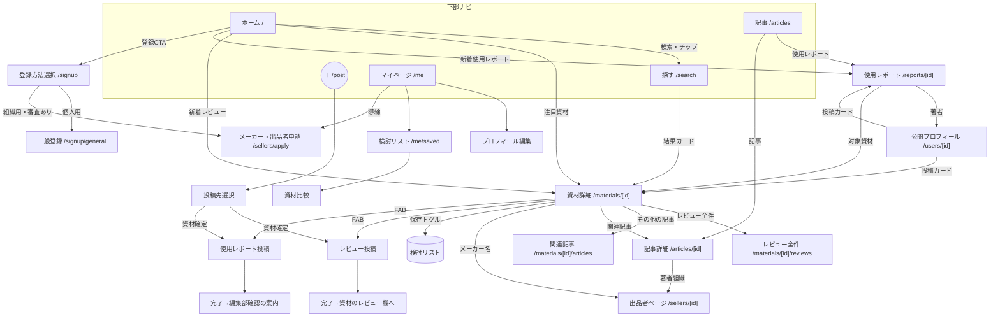

# 02 画面設計 — 一覧・遷移・モック監査の反映

前提：スマホ版モックアップ（[reference/mockup-sp-19screens.html](reference/mockup-sp-19screens.html)）が375px表示の見た目の正。本書はモックを URL ルーティング・データ駆動の実アプリに落とすための差分と、監査で見つかった欠落画面の補完を定義する。スマホ表示を最優先しつつ、PCでは同じ部品を引き伸ばさず、画面幅に合う情報設計へ切り替える。

## 1. 情報設計の原則

- `lg` 未満の下部ナビ5枠：**ホーム／探す／＋投稿／記事／マイページ**（モック準拠）。＋は投稿先選択（資材を確定してからレビュー／使用レポートに分岐）
- `lg` 以上は下部ナビを表示せず、ロゴ・資材検索入口・投稿・使用レポート一覧・マイページを持つPCヘッダーへ置き換える。公開画面と出品者ワークスペースは別の chrome を使い、同じヘッダーへ条件を詰め込まない
- 資材詳細＝倉庫：エビデンス・レビュー・使用レポート抜粋・関連記事を**埋め込み**で同居させ、ページ内スクロールで確かめられる。独立画面が要るのは使用レポートと記事のみ
- モックは画面 ID しか渡さない静的プロトタイプ。実装ではすべての詳細画面が**レコード ID を URL で受ける**（/materials/[id] 等）。モックの「全カードが同一詳細に飛ぶ」「タイトルの Skeepon 固定」はプロトタイプの簡略化であり、仕様ではない

## 2. ルーティング一覧（Phase 1）

### 公開（非ログイン閲覧可・D6）

| ルート | 画面 | モック対応 | 備考 |
|---|---|---|---|
| `/` | ホーム | home | 検索画面へ進む単一の検索入口・注目資材・新着使用レポート・新着レビュー・登録 CTA。候補や条件チップは展開しない |
| `/search` | 資材検索 | search | 効果・作物・製品タイプ・悩み・栽培条件の選択（同一分類 OR・分類間 AND）・並び替え（レビュー数／評価／新着を実装） |
| `/materials/[id]` | 資材詳細 | material | Q&A 区画は**非表示**（Phase 2）。追加：保存トグル・対照区あり率の1行・レビュー全件への導線 |
| `/materials/[id]/reviews` | レビュー全件一覧 | （新規） | モックの「すべて見る（32件）」行き止まりの解消。並び替え付き |
| `/materials/[id]/articles` | 資材の関連記事一覧 | materialArticles | 資材名は動的 |
| `/reports/[id]` | 使用レポート閲覧 | reportArticle | published のみ公開。FAB は資材詳細と同一仕様 |
| `/articles` | 記事・使用レポート一覧 | articles | フィルタピル（すべて／使用レポート／記事）を実装。検索も実装 |
| `/articles/[id]` | 記事詳細 | articleDetail | 著者（出品者）ページへのリンクは seller_type を問わず動作させる（モックの sellerJA 孤立を解消） |
| `/sellers/[id]` | 出品者ページ | seller ＋ sellerJA | **1画面に統合**。掲載資材0件時は告知バンド表示に分岐。公式回答区画と回答数は Phase 2 まで非表示。「掲載製品 N 件」は全件一覧への導線を付ける |
| `/users/[id]` | 公開プロフィール | profilePublic | 所属バッジ表示（D5）。レビューカード・使用レポートの著者名すべてからリンクする（モックは1経路のみだった） |

### 要ログイン（一般ユーザー）

| ルート | 画面 | モック対応 | 備考 |
|---|---|---|---|
| `/post` | 投稿先選択 | pickMaterial | 選択した資材 ID を後続フォームへ引き継ぐ（モックは未接続だった）。出品者・運営が開いた場合は URL を維持し、一般ユーザー専用である旨と各管理画面への導線を表示する |
| `/materials/[id]/review/new` | レビュー投稿 | reviewForm | 項目確定：作目（1件以上必須・複数選択・検索＋選択チップ。プロフィールの主な作目は候補として先頭表示）・星（必須・**タップ入力を実装**）・本文（必須）・写真（任意）・購入場所（任意・内部）・対照区の有無（任意）・農薬表現同意（必須・未同意は送信ブロック） |
| `/materials/[id]/report/new` | 使用レポート投稿 | reportForm | モックの6セクション構成を踏襲。下書き保存を実装。送信で pending へ |
| 投稿完了 | 完了 | done | **種別で分岐**：レビュー→資材詳細のレビュー欄アンカーへ「投稿を見る」、使用レポート→「編集部で確認後に公開されます」の案内 |
| `/me` | マイページ | mypage | 棚を追加：自分の投稿（下書き・調整中・公開済み）／検討リスト／参考になったを付けた一覧。出品者申請への導線もここに置く |
| `/me/edit` | プロフィール編集 | （新規） | モックの非機能ボタンの実装。登録項目＋任意項目の編集 |
| `/me/saved` | 検討リスト | （新規） | 保存資材の一覧・解除・**比較へ**（2〜4件選択で簡易比較表） |
| `/me/saved/compare` | 資材比較 | （新規） | 選択資材の基本情報・評価・対照区あり率・主な分類を列で並べる簡易表 |
| レビュー編集・削除 | モーダル／再利用フォーム | （新規） | 自分のレビューのみ。削除は確認ダイアログ |
| 通報 | モーダル | （新規） | レビュー・使用レポート・記事・プロフィールに設置 |

### 認証（一般ユーザー／メーカー・出品者を分離）

| ルート | 画面 | 備考 |
|---|---|---|
| `/signup` | 登録方法選択 | 個人用の一般ユーザーと、審査制のメーカー・出品者アカウントを入力前に分岐させる |
| `/signup/general` | 一般登録 | モック signup 準拠＋**完了遷移を実装**（登録→メール確認→ホーム）。立場は内部専用で、メーカー関係者を選んでも個人用アカウントになる旨を明記 |
| `/login` | 一般ログイン | 新規。パスワード再設定への導線 |
| `/password-reset` | 再設定 | 新規 |
| `/sellers/login` | 出品者ログイン | 新規。ログイン ID＋パスワード（合成メールへの解決は BFF 内） |
| `/sellers/apply` | メーカー・出品者申請 | モック sellerApply 準拠＋**導線接続**（登録方法選択・マイページ・出品者ログイン画面から）＋送信後の受付完了画面。招待コード入力を実装 |
| `/sellers/apply/done` | 申請受付完了 | 新規。審査の目安（3営業日）を表示 |

### 出品者ダッシュボード（要 seller ログイン・新規設計）

| ルート | 画面 | 備考 |
|---|---|---|
| `/dashboard` | 出品者ホーム | 自社資材一覧（claim 済み）・記事一覧・アカウント情報 |
| `/dashboard/materials/[id]` | 一次情報編集 | 紹介文・一般用途・主成分・作用機序・使い方・価格帯・公式 URL・エビデンス管理（SDS／論文／チラシの追加削除）。分類・検索層は閲覧のみ＋「分類変更を申請」 |
| `/dashboard/articles` ・ `/dashboard/articles/new` ・ `[id]/edit` | 記事管理・投稿・編集 | タイトル・本文（Markdown・画像挿入）・紐づけ資材（複数・他社可）・下書き／公開 |

### 運営管理（要 admin＋AAL2・新規設計・デザインはモック基準外）

| ルート | 機能 |
|---|---|
| `/admin/sellers` | 出品者審査（applied 一覧→承認＝共有ログイン発行／却下）・招待コード発行 |
| `/admin/materials` | 資材の登録（種まき）・編集（全層）・claim 紐づけ・分類変更申請の処理 |
| `/admin/tags` | 検索補助タグ・作物マスタ管理。その他の資材分類は初期マスタから資材編集画面で選択する |
| `/admin/reports` | 通報処理（対象の非公開化・却下） |
| `/admin/usage-reports` | 編集局：pending 一覧→本文調整・タイトル付け・収穫調査データ確認→公開／差し戻し |

## 3. 画面遷移図（一般ユーザーの主要導線）

> 本節の図は設計時の簡略版。**実装準拠の完全な画面遷移図（公開／一般・出品者・運営の3枚＋アクセス制御表）は [06-diagrams.md](06-diagrams.md) §3** を参照。

出品者・運営系は独立の導線（`/sellers/login` → `/dashboard`、`/admin/*`）で、一般側のナビには混ぜない。

### 3.1 レスポンシブ契約

| 画面幅 | chrome | コレクションと本文 |
|---|---|---|
| 375px 基準 | Mobile AppBar＋画面下固定 BottomNav | 資材・使用レポートは横レール、フォームは全幅 |
| 768px〜1023px | モバイル側の chrome を維持 | 内容に応じて2〜3列化してよい。ナビの切り替え点とは独立に判断する |
| 1024px 以上（`lg`） | Desktop Site Header。出品者は専用 Workspace Header | 横レールをグリッドへ置換し、一覧・詳細・フォームごとの上限幅を適用する |

公開画面のモバイル用とPC用の chrome は両方をSSRし、Pandaのレスポンシブ `display` で相互排他にする。JSによる画面幅判定は使わない。詳細本文の可読幅と一覧の列数は、chromeの切り替えとは別に決める。

### 3.2 ホーム検索と公開ヘッダー

- モバイルヘッダーは左にFarmilleロゴ、右に検索アイコンを置き、検索アイコンは `/search` へ遷移する
- PCヘッダーはFarmilleロゴ、使用レポート一覧、資材検索入口、投稿、マイページの順に常設する。使用レポート一覧は `/articles?type=report` へ遷移する
- ホームの検索入口は「資材を検索する（作物・悩み・資材名から）」と「検索へ →」を1つのリンクとして扱い、クリック領域全体を `/search` へ接続する
- 入力候補、選択済み条件、0件表示、読み込み、取得エラーは `/search` が担当する。ホームは検索データを取得せず、入口が利用できる状態だけを持つ

## 4. モック監査の結論と反映（実装者は必ず読むこと）

3資料（要件定義・OOUI・モック）の突き合わせで見つかった主要な不整合と、その解決。ここに書いた解決が正であり、モックの該当箇所より優先する。

| # | 発見 | 解決 |
|---|---|---|
| 1 | 所属バッジの三つ巴矛盾（要件定義＝表示しない／OOUI＝プロフィールのみ／モック＝バッジあり） | **モック準拠で表示**（D5）。任意項目。投稿カードには出さない |
| 2 | レビュー投稿項目が3資料で不一致（購入場所・対照区・農薬同意・栽培条件） | §2 のレビュー投稿の項目定義が正。栽培条件はレビューに持たない（プロフィール参照） |
| 3 | OOUI は「記事 Phase 2」だが確定スコープは Phase 1 | 記事は Phase 1（D3）。出品者 v1 権限＝claim＋一次情報編集＋記事投稿 |
| 4 | 検討リストが OOUI の中核なのにモックに保存導線が無い | 資材詳細・資材カードに保存トグル、/me/saved を新設 |
| 5 | Q&A 区画がモックの資材詳細・出品者ページに残っている | v1 では非表示。スキーマのみ先行 |
| 6 | seller と sellerJA が別画面で JA 側は導線ゼロ | 1画面に統合し掲載0件で分岐 |
| 7 | 用語不統一（口コミ／レビュー、処理区／対照区 等） | D8 の用語対応表に統一 |
| 8 | 資材詳細の8項目の所有権（メーカー編集か Farmille 所有か）が未割当 | 01 §3 materials の層割当が正 |
| 9 | レビューカードに閲覧数表示（モックのみ） | レビューカードから閲覧数を**削除**。閲覧イベントは両対象で記録は継続 |
| 10 | 認証・出品者作業・自己管理画面の全面欠落、行き止まり多数（登録ボタン非機能・done 固定遷移・「すべて見る」未接続・sellerApply 孤立・プロフィール編集非機能・星入力不可・フィード導線ゼロ） | §2 の新規画面群と分岐仕様で解消。フィードは Phase 2 のまま |
| 11 | 収穫調査グラフが「編集部作成」前提 | 生数値を usage_report_metrics に構造化保存し、グラフは表示時生成（編集部の画像添付も可） |
| 12 | モックの非機能要素（参考になった・写真追加・同意チェック・下書き保存・ソート select） | すべて実装対象。モックに挙動が無いことを「仕様が無い」と解釈しない |
| 13 | モックにダークテーマとテーマ切替ボタンがある | v1 では実装しない（D12）。ライトのみ |

## 5. デザイントークン（モックから抽出 → Panda CSS トークンへ）

モックの `:root`（ライト）定義を正とする。**ダークモードは実装しない**（D12）。モック HTML には `data-theme="dark"` の定義とテーマ切替ボタンがあるが、v1 では移植せず、切替 UI も置かない。

| トークン | 値 |
|---|---|
| green（プライマリ） | #2E7D32 |
| green.deep | #1B5E20 |
| green.soft / soft2 | #E8F5E9 / #F1F8F2 |
| blue（公式マーク） | #1976D2 |
| star | #F5A623 |
| amber / amber.soft（警告） | #B26A00 / #FFF4E0 |
| bg / panel / card | #F8F8F5 / #FAFAF7 / #FFFFFF |
| ink / ink2 / ink3 | #1E231F / #4C534D / #7C837D |
| line / line.strong | #E7E5DE / #D8D6CD |
| shadow | 0 1px 2px rgba(30,35,31,.05), 0 4px 14px rgba(30,35,31,.06) |
| shadow.lift | 0 8px 30px rgba(30,35,31,.16) |
| フォント | Noto Sans JP 系スタック（-apple-system, Hiragino Kaku Gothic ProN, Hiragino Sans, Noto Sans JP, Yu Gothic, Meiryo） |
| 角丸 | pill=999px／card=14px／button=12px／input=11px |
| 画像比率 | square=1：1／landscape=4：3／wide=16：9／portrait=3：4。画像枠に適用し、画像は `cover` または `contain` で収める |
| タイポ | 21/20/17-19/16/14-14.5/12-13/9.5-11px の8段 |
| 余白 | 8px 刻み基調（6/8/10/12/16） |
| 上限幅 | card.materialMobile=9.375rem／card.material=15rem／dialog=24rem／auth=26.875rem／content.form=44rem／content.reading=48rem／content.medium=56rem／content.workspace=60rem／content.wide=75rem |

生値の直書きは禁止し、すべて Panda の tokens / semanticTokens を経由する（03 §3・§8）。モックの `--phone:44px`（フォン枠の角丸）はプロトタイプの外枠用なので移植しない。

主要共通コンポーネント（モックの関数と対応）：AppBar／BottomNav／FabBar／MaterialCard／ReviewCard（閲覧数なし版）／ReportCard／ArticleCard／TagChip（分類色）／StarRating（表示・入力）／StatCard／SectionHeading／FilterPills／CalendarPicker（使用レポート用）。
