# 06 図解 — ER 図・シーケンス図・画面遷移図

生成元：`supabase/migrations/` 全15本と `src/` の実装（2026-08-24・ブランチ rebuild/m0）。設計書（01・02）の図は概念設計時の簡略版であり、**実装と食い違う場合は本書が正**。スキーマ・ルーティング・主要フローを変更する PR は本書の該当図も更新すること。

GitHub 上でそのまま Mermaid がレンダリングされる。閲覧用のスタンドアロン版（同一ソースから生成）：https://claude.ai/code/artifact/cbd39abf-0d38-4b1e-92c5-38d943f1765f

- [1. ER 図](#1-er-図)
- [2. シーケンス図](#2-シーケンス図)
- [3. 画面遷移図](#3-画面遷移図)

---

## 1. ER 図

38 テーブル。読みやすさのため「全体俯瞰」＋ドメイン別 4 枚に分割する。列はすべて実物どおり（`created_at`／`updated_at` は全テーブルにあるため各図では省略）。点線＝ポリモーフィック参照（FK 制約なし・`target_type`＋`target_id`）。

### 1.1 全体俯瞰

```mermaid
erDiagram
    auth_users ||--o| profiles : "一般ユーザー 1:1"
    auth_users ||--o| seller_accounts : "共有ログイン 1:0..1"

    profiles ||--o{ profile_crops : ""
    crop_groups ||--o{ crops : ""
    crops ||--o{ profile_crops : ""

    seller_accounts ||--o{ materials : "claim（NULL=未claim）"
    seller_accounts ||--o{ articles : "著者"
    seller_accounts ||--o{ material_edit_requests : "申請"

    composition_types ||--o{ materials : "組成"
    materials ||--o{ material_effects : ""
    effects ||--o{ material_effects : ""
    effect_categories ||--o{ effects : ""
    materials ||--o{ material_crops : ""
    crops ||--o{ material_crops : ""
    materials ||--o{ material_search_tags : ""
    search_tags ||--o{ material_search_tags : ""
    materials ||--o{ material_ingredient_categories : ""
    ingredient_categories ||--o{ material_ingredient_categories : ""
    materials ||--o{ material_ingredients : ""
    ingredients ||--o{ material_ingredients : ""
    ingredient_categories ||--o{ ingredients : ""
    materials ||--o{ material_product_types : ""
    product_types ||--o{ material_product_types : ""
    materials ||--o{ material_images : ""
    materials ||--o{ material_evidences : ""
    materials ||--o{ material_sources : ""
    materials ||--o{ material_edit_requests : ""
    materials ||--o{ reviews : ""
    materials ||--o{ usage_reports : ""
    materials ||--o{ saved_materials : ""
    materials ||--o{ article_materials : ""
    materials ||--o{ questions : "Phase2"

    profiles ||--o{ reviews : "投稿"
    profiles ||--o{ usage_reports : "投稿"
    profiles ||--o{ saved_materials : "検討リスト"
    profiles ||--o{ helpful_votes : "参考になった"
    profiles ||--o{ content_reports : "通報"
    reviews ||--|{ review_crops : "作目（1件以上）"
    crops ||--o{ review_crops : ""
    crops ||--o{ usage_reports : "作目"

    reviews ||--o{ review_photos : ""
    usage_reports ||--o{ usage_report_applications : ""
    usage_reports ||--o{ usage_report_media : ""
    usage_reports ||--o{ usage_report_metrics : ""

    articles ||--o{ article_materials : ""
    questions ||--o{ answers : "Phase2"

    helpful_votes }o..o{ reviews : "対象(FKなし)"
    helpful_votes }o..o{ usage_reports : "対象(FKなし)"
    content_reports }o..o{ reviews : "対象(FKなし)"
    view_events }o..o{ materials : "対象(FKなし)"
```

### 1.2 アカウント

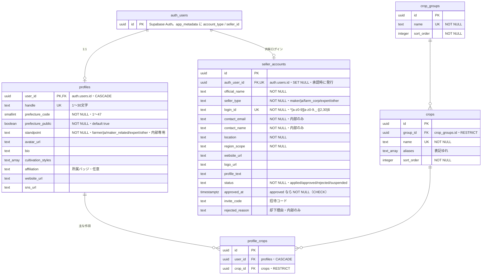

補足：`profile_crops` は `(user_id, crop_id)` UNIQUE。

### 1.3 資材と分類（2層所有）

```mermaid
erDiagram
    materials {
        uuid id PK
        text name "NOT NULL・分類層=Farmille"
        text manufacturer_name "NOT NULL・分類層"
        uuid composition_type_id FK "composition_types・RESTRICT・分類層"
        text sales_status "分類層"
        text description "一次情報層=出品者編集可"
        text general_use "一次情報層"
        text main_components "一次情報層・主成分原文"
        text mechanism "一次情報層"
        text usage_text "一次情報層"
        text price_range "一次情報層"
        text official_url "一次情報層"
        text catalog_url "一次情報層"
        uuid seller_id FK "seller_accounts・SET NULL・NULL=未claim"
        integer review_count "集計・トリガー更新"
        numeric avg_rating "集計・1〜5・0件はNULL"
        numeric control_plot_ratio "集計・対照区あり率"
    }
    effect_categories {
        uuid id PK
        text name UK "NOT NULL"
        integer sort_order "NOT NULL"
    }
    effects {
        uuid id PK
        uuid category_id FK "effect_categories・RESTRICT"
        text name "NOT NULL"
        integer sort_order "NOT NULL"
    }
    material_effects {
        uuid id PK
        uuid material_id FK "CASCADE"
        uuid effect_id FK "RESTRICT"
    }
    material_crops {
        uuid id PK
        uuid material_id FK "CASCADE"
        uuid crop_id FK "crops・RESTRICT"
        text source_name "メーカー資料の記載名・NOT NULL"
        integer sort_order "NOT NULL"
    }
    ingredient_categories {
        uuid id PK
        text name UK "NOT NULL・JBSA材料分類"
        integer sort_order "NOT NULL"
    }
    ingredients {
        uuid id PK
        uuid category_id FK "ingredient_categories・RESTRICT"
        text name "NOT NULL・個別材料"
        integer sort_order "NOT NULL"
    }
    material_ingredient_categories {
        uuid id PK
        uuid material_id FK "CASCADE"
        uuid ingredient_category_id FK "RESTRICT"
    }
    material_ingredients {
        uuid id PK
        uuid material_id FK "CASCADE"
        uuid ingredient_id FK "RESTRICT"
    }
    composition_types {
        uuid id PK
        text name UK "NOT NULL"
        integer sort_order "NOT NULL"
    }
    product_types {
        uuid id PK
        text name UK "NOT NULL・メーカー分類"
        integer sort_order "NOT NULL"
    }
    material_product_types {
        uuid id PK
        uuid material_id FK "CASCADE"
        uuid product_type_id FK "RESTRICT"
    }
    search_tags {
        uuid id PK
        text name "NOT NULL"
        text category "NOT NULL・concern/condition"
        integer sort_order "NOT NULL"
    }
    material_search_tags {
        uuid id PK
        uuid material_id FK "CASCADE"
        uuid search_tag_id FK "CASCADE"
    }
    material_images {
        uuid id PK
        uuid material_id FK "CASCADE"
        text url "NOT NULL"
        text image_type "package/logo/usage_scene/other"
        integer sort_order
    }
    material_evidences {
        uuid id PK
        uuid material_id FK "CASCADE"
        text evidence_type "NOT NULL・sds/paper/trial/leaflet"
        text title "NOT NULL"
        text file_url "file か external のどちらか必須（CHECK）"
        text external_url
        jsonb meta
        integer sort_order
    }
    material_sources {
        uuid id PK
        uuid material_id FK "CASCADE"
        text source_url "NOT NULL・出典"
        text source_type
        text note
    }
    material_edit_requests {
        uuid id PK
        uuid material_id FK "CASCADE"
        uuid seller_id FK "CASCADE・申請者"
        text request_text "NOT NULL"
        text status "NOT NULL・open/done/declined"
    }
    seller_accounts {
        uuid id PK
    }

    seller_accounts ||--o{ materials : "claim"
    composition_types ||--o{ materials : "組成タイプ"
    effect_categories ||--o{ effects : "効果大分類"
    effects ||--o{ material_effects : ""
    materials ||--o{ material_effects : "個別効果"
    crops ||--o{ material_crops : "Farmille正規化"
    materials ||--o{ material_crops : "対象作物"
    ingredient_categories ||--o{ ingredients : "所属"
    ingredient_categories ||--o{ material_ingredient_categories : ""
    materials ||--o{ material_ingredient_categories : "JBSA材料分類"
    ingredients ||--o{ material_ingredients : ""
    materials ||--o{ material_ingredients : "個別材料"
    product_types ||--o{ material_product_types : ""
    materials ||--o{ material_product_types : "製品タイプ"
    search_tags ||--o{ material_search_tags : ""
    materials ||--o{ material_search_tags : "発見語"
    materials ||--o{ material_images : ""
    materials ||--o{ material_evidences : ""
    materials ||--o{ material_sources : ""
    materials ||--o{ material_edit_requests : ""
    seller_accounts ||--o{ material_edit_requests : ""
```

補足：`materials` は `(name, manufacturer_name)` UNIQUE。同一分類内の検索条件は OR、分類間は AND。効果大分類と作物群は表示用に導出し、資材との直接関連を重複保存しない。分類層＋集計＋`seller_id` はトリガー `enforce_material_column_scope` で保護され、出品者は一次情報層のみ更新できる（admin と service_role は素通り）。

### 1.4 投稿とリアクション

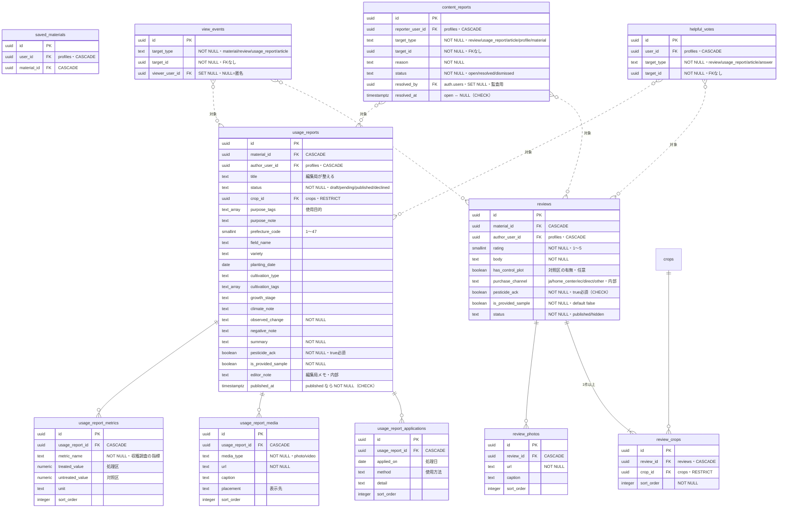

補足：`review_crops` は `(review_id, crop_id)` UNIQUEで、遅延制約トリガーがレビューごとの0件を拒否する。`saved_materials` は `(user_id, material_id)` UNIQUE、`helpful_votes` は `(user_id, target_type, target_id)` UNIQUE。`view_events` は追記専用（UPDATE/DELETE 権限を剥奪）。`reviews` の INSERT/UPDATE/DELETE で集計トリガーが `materials.review_count / avg_rating / control_plot_ratio` を再計算する。

### 1.5 記事・Q&A（Phase 2 先行スキーマ）

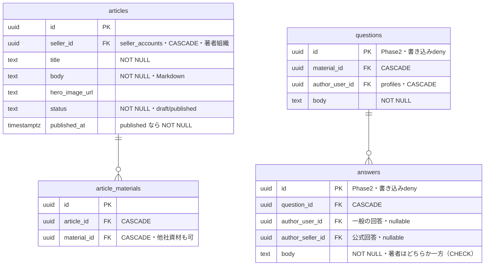

### 1.6 ビューと Storage（図外の公開面）

| ビュー | 権限 | 内容 |
|---|---|---|
| `public_profiles` | definer・SELECT のみ | profiles の公開列のみ（standpoint・非公開 prefecture を遮断） |
| `public_sellers` | invoker＋列 GRANT | approved の seller のみ・contact_*／invite_code／rejected_reason を遮断 |
| `helpful_counts` | definer・SELECT のみ | helpful_votes の件数集計（個票は本人のみ） |
| `view_counts_daily` | definer・SELECT のみ | view_events の JST 日次集計（生ログは admin のみ） |

| Storage バケット | 上限 | 書き込み主体（パス先頭＝所有者） |
|---|---|---|
| avatars | 2MB | 一般本人 `{user_id}/…` |
| review-photos | 5MB | 一般本人 |
| report-media | 50MB（動画可） | 一般本人 |
| material-images | 5MB | 出品者 `{seller_id}/…`・admin |
| article-images | 5MB | 出品者・admin |

---

## 2. シーケンス図

アクター表記：**ブラウザ**／**server**（Server Action＋src/server 層）／**Auth**（Supabase Auth）／**DB**（Postgres・RLS）／**Storage**。

### 2.1 一般ユーザー登録（補償処理付き）

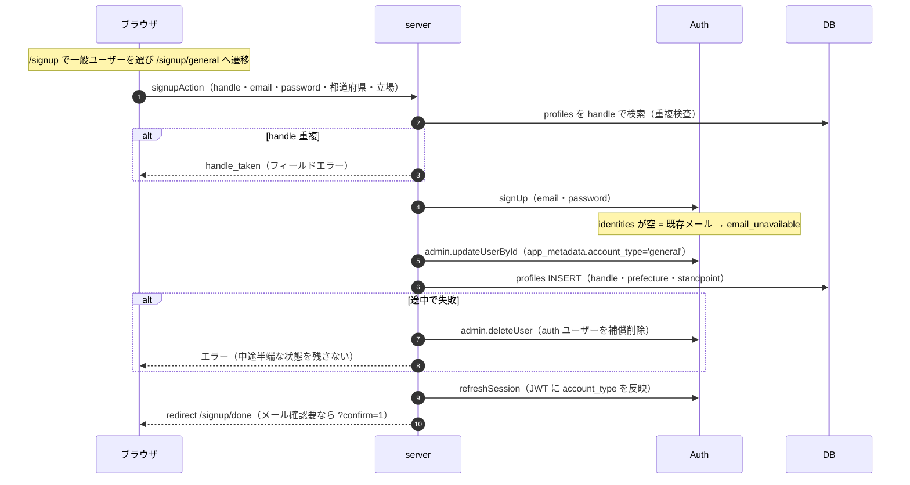

### 2.2 出品者ログイン（共有 ID・合成メール方式）

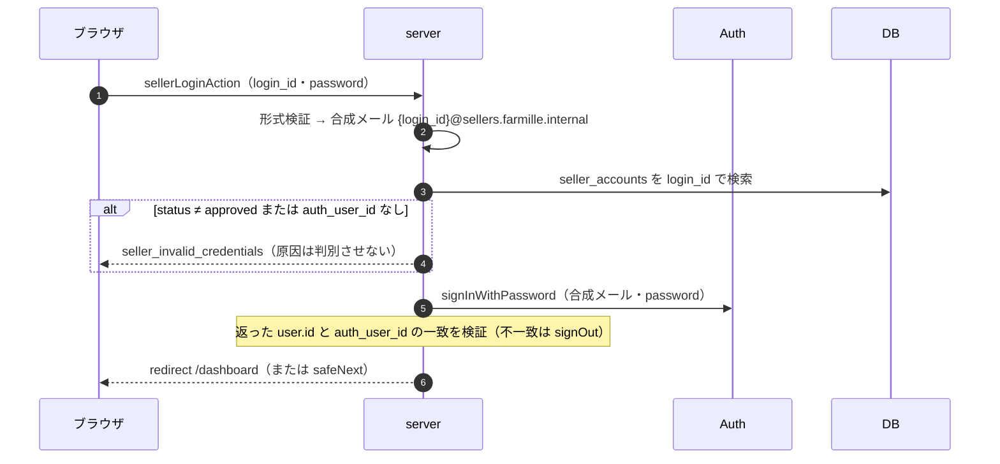

### 2.3 出品者申請 → admin 承認

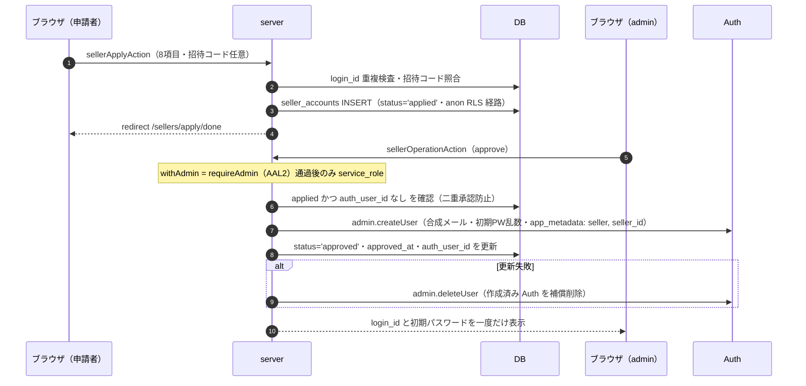

### 2.4 admin の AAL2（TOTP enroll → verify）

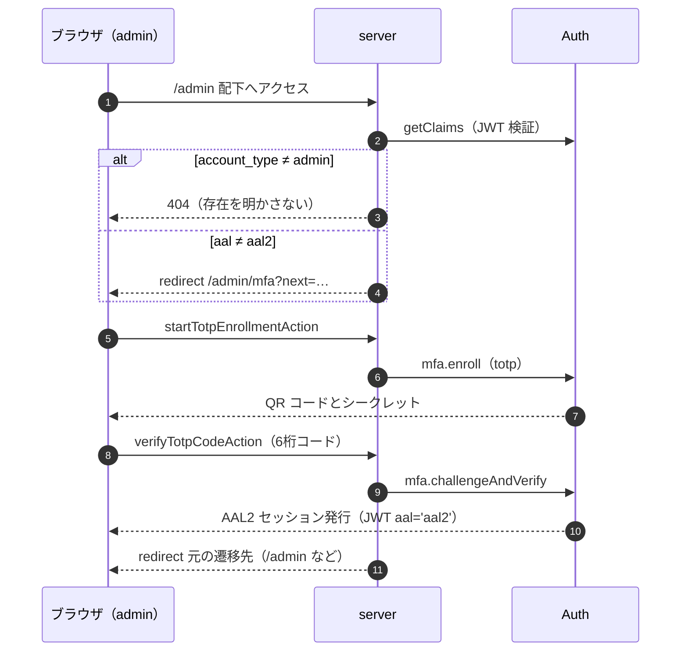

### 2.5 レビュー投稿（Storage 直アップロード＋集計トリガー）

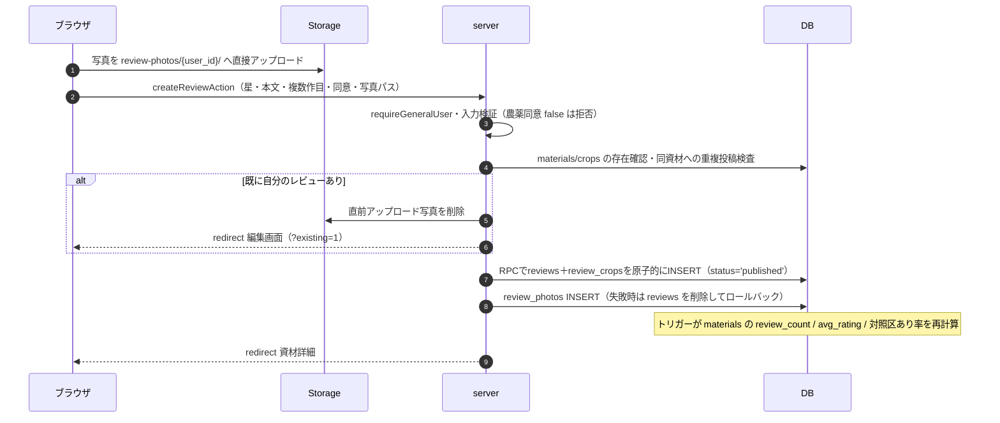

### 2.6 使用レポートのライフサイクル（編集局ワークフロー）

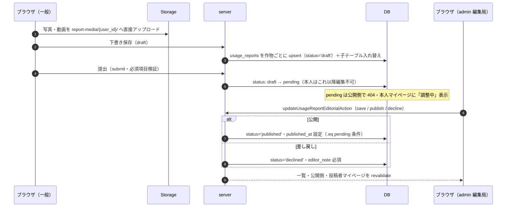

---

## 3. 画面遷移図

凡例：実線＝リンク／リダイレクト。`login?next=` への誘導は「🔒」で略記（未ログイン時）。BottomNav（ホーム・探す・＋投稿・記事・マイページ）は公開＋一般側の全画面に共通なので個別エッジは省略。

認証とアカウント作成の分岐は、実画面スクリーンショットを使った [07-account-screen-flow.md](07-account-screen-flow.md) も併せて参照する。

### 3.1 公開＋一般ユーザー

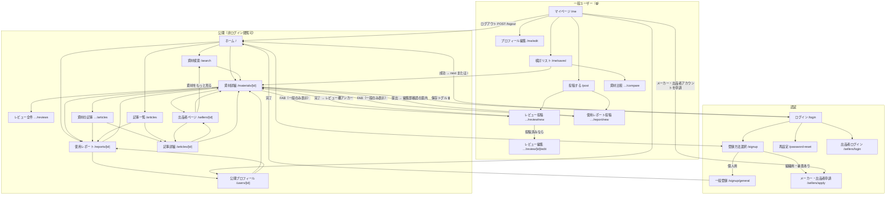

### 3.2 出品者

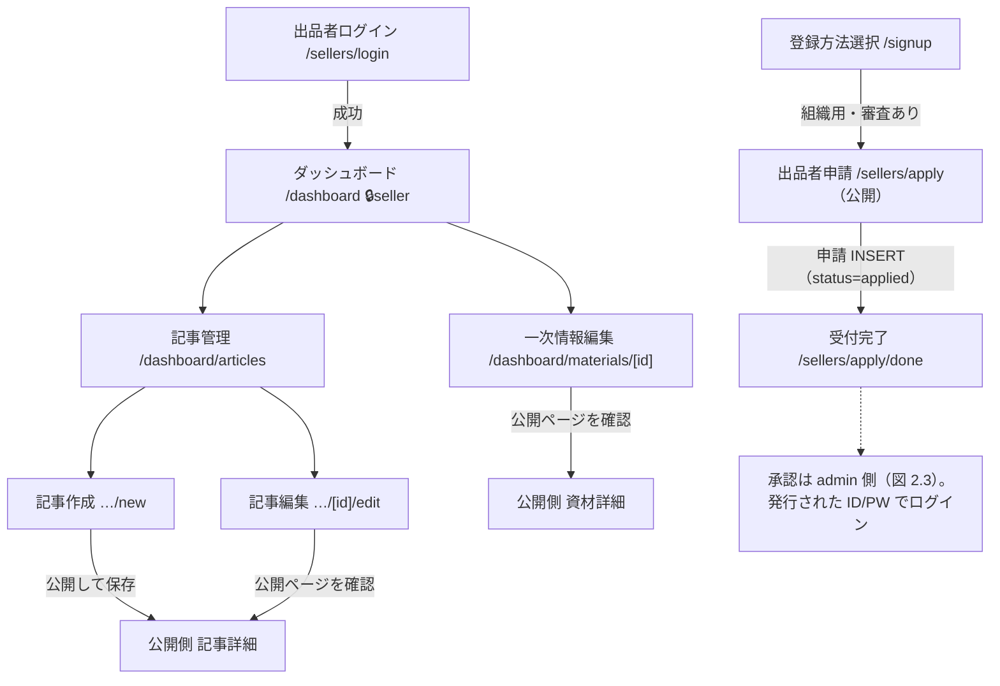

### 3.3 運営管理（admin・AAL2 必須）

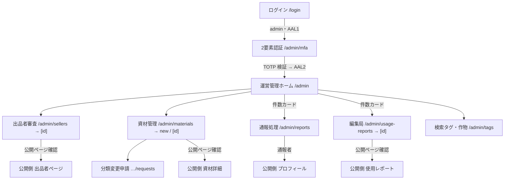

### 3.4 アクセス制御の要点（図の前提）

| 領域 | 一次防御 | 挙動 |
|---|---|---|
| `/signup` `/signup/general` | proxy | ログイン済み→`/`。一般登録と組織用申請を入力前に分岐 |
| `/me` `/post` | proxy＋ページ内 | 未ログイン→`/login?next=`。出品者・admin が開くと、URLを維持して各管理画面への案内を表示 |
| `/dashboard` | proxy＋`requireSeller` | 未ログイン→`/sellers/login?next=`。非出品者は画面内で拒否表示 |
| `/admin` | `requireAdminPage` | 未ログイン→`/login`。AAL1 の admin→`/admin/mfa`。admin 以外→**404**（存在を明かさない） |
| 通報・削除確認 | — | ページ遷移ではなくモーダル（`<dialog>`）。通報はレビュー・レポート・記事・プロフィールの4箇所 |
