# 06 図解 — ER 図・シーケンス図・画面遷移図

生成元：`supabase/migrations/` 全21本と `src/` の実装（2026-09-04・ブランチ rebuild/m0）。設計の正は [01-domain-model.md](01-domain-model.md)、[02-screens.md](02-screens.md)、[08-material-governance-ooui.md](08-material-governance-ooui.md) とし、本書は実装全体を横断する図解として同期する。スキーマ・ルーティング・主要フローを変更する際は本書の該当図も更新する。

GitHub 上でそのまま Mermaid がレンダリングされる。閲覧用のスタンドアロン版（同一ソースから生成）：https://claude.ai/code/artifact/cbd39abf-0d38-4b1e-92c5-38d943f1765f

- [1. ER 図](#1-er-図)
- [2. シーケンス図](#2-シーケンス図)
- [3. 画面遷移図](#3-画面遷移図)

---

## 1. ER 図

45 テーブル。読みやすさのため「全体俯瞰」＋ドメイン別 4 枚に分割する。`created_at`／`updated_at` は各図では省略する。点線はポリモーフィック参照（FK 制約なし・`target_type`＋`target_id`）を示す。

### 1.1 全体俯瞰

```mermaid
erDiagram
    auth_users ||--o| profiles : "一般ユーザー 1:1"
    auth_users ||--o| seller_accounts : "共有ログイン 1:0..1"

    crop_groups ||--o{ crops : ""

    seller_accounts ||--o{ materials : "claim（NULL=未claim）"
    seller_accounts ||--o{ articles : "著者"
    seller_accounts ||--o{ material_change_requests : "申請"

    composition_types ||--o{ materials : "組成"
    materials ||--o{ material_effects : ""
    effects ||--o{ material_effects : ""
    effect_categories ||--o{ effects : ""
    materials ||--o{ material_crops : ""
    crops ||--o{ material_crops : ""
    materials ||--o{ material_search_tags : ""
    search_tags ||--o{ material_search_tags : ""
    materials ||--o{ material_ingredient_categories : ""
    ingredient_categories ||--o{ material_ingredient_categories : ""
    materials ||--o{ material_ingredients : ""
    ingredients ||--o{ material_ingredients : ""
    ingredient_categories ||--o{ ingredients : ""
    materials ||--o{ material_product_types : ""
    product_types ||--o{ material_product_types : ""
    materials ||--o{ material_images : ""
    materials ||--o{ material_evidences : ""
    materials ||--o{ material_sources : ""
    materials ||--o{ material_change_requests : "対象"
    material_change_requests ||--o| material_change_request_details : "提案内容"
    material_change_requests ||--o{ material_change_request_evidences : "提案エビデンス"
    materials ||--o{ reviews : ""
    materials ||--o{ usage_reports : ""
    materials ||--o{ saved_materials : ""
    materials ||--o{ article_materials : ""
    materials ||--o{ questions : "Phase2"

    profiles ||--o{ reviews : "投稿"
    profiles ||--o{ usage_reports : "投稿"
    profiles ||--o{ saved_materials : "検討リスト"
    profiles ||--o{ helpful_votes : "参考になった"
    profiles ||--o{ content_reports : "通報"
    reviews ||--|| review_crops : "作目（1件）"
    crops ||--o{ review_crops : ""
    crops ||--o{ usage_reports : "作目"

    reviews ||--o{ review_photos : ""
    usage_reports ||--o{ usage_report_applications : ""
    usage_reports ||--o{ usage_report_media : ""
    usage_reports ||--o{ usage_report_metrics : ""

    articles ||--o{ article_materials : ""
    questions ||--o{ answers : "Phase2"

    helpful_votes }o..o{ reviews : "対象(FKなし)"
    helpful_votes }o..o{ usage_reports : "対象(FKなし)"
    content_reports }o..o{ reviews : "対象(FKなし)"
    view_events }o..o{ materials : "対象(FKなし)"
```

### 1.2 アカウント

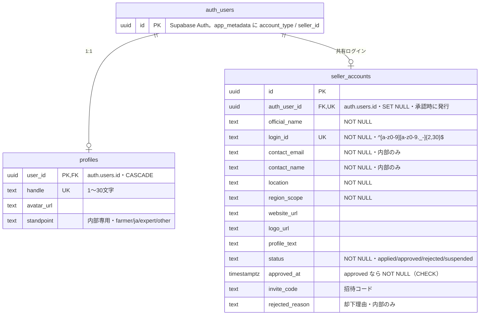

補足：一般ユーザーの `profiles` は投稿者識別用のハンドルとアバターに加え、内部専用の立場を4択で保持する。立場は公開ビューや投稿に出さず、地域・栽培情報・所属などの属性は持たない。

### 1.3 資材と分類（2層所有）

```mermaid
erDiagram
    materials {
        uuid id PK
        text name "NOT NULL・分類層=Farmille"
        text manufacturer_name "NOT NULL・分類層"
        uuid composition_type_id FK "composition_types・RESTRICT・分類層"
        text sales_status "分類層"
        text description "承認済み正本・紹介文"
        text general_use "承認済み正本・一般用途"
        text main_components "承認済み正本・主成分原文"
        text mechanism "承認済み正本・作用機序"
        text usage_text "承認済み正本・使い方"
        text price_range "承認済み正本"
        text official_url "承認済み正本"
        text catalog_url "承認済み正本"
        uuid seller_id FK "seller_accounts・SET NULL・NULL=未claim"
        text publication_status "published/archived"
        timestamptz archived_at "掲載終了日時"
        integer content_revision "承認済み正本の版"
        timestamptz manufacturer_verified_at "メーカー確認日時"
        uuid manufacturer_verified_by_seller_id FK "確認したメーカー"
        text manufacturer_verification_method "確認経路"
        integer review_count "集計・トリガー更新"
        numeric avg_rating "集計・1〜5・0件はNULL"
        numeric control_plot_ratio "集計・対照区あり率"
    }
    effect_categories {
        uuid id PK
        text name UK "NOT NULL"
        integer sort_order "NOT NULL"
    }
    effects {
        uuid id PK
        uuid category_id FK "effect_categories・RESTRICT"
        text name "NOT NULL"
        integer sort_order "NOT NULL"
    }
    material_effects {
        uuid id PK
        uuid material_id FK "CASCADE"
        uuid effect_id FK "RESTRICT"
    }
    material_crops {
        uuid id PK
        uuid material_id FK "CASCADE"
        uuid crop_id FK "crops・RESTRICT"
        text source_name "メーカー資料の記載名・NOT NULL"
        integer sort_order "NOT NULL"
    }
    ingredient_categories {
        uuid id PK
        text name UK "NOT NULL・JBSA材料分類"
        integer sort_order "NOT NULL"
    }
    ingredients {
        uuid id PK
        uuid category_id FK "ingredient_categories・RESTRICT"
        text name "NOT NULL・個別材料"
        integer sort_order "NOT NULL"
    }
    material_ingredient_categories {
        uuid id PK
        uuid material_id FK "CASCADE"
        uuid ingredient_category_id FK "RESTRICT"
    }
    material_ingredients {
        uuid id PK
        uuid material_id FK "CASCADE"
        uuid ingredient_id FK "RESTRICT"
    }
    composition_types {
        uuid id PK
        text name UK "NOT NULL"
        integer sort_order "NOT NULL"
    }
    product_types {
        uuid id PK
        text name UK "NOT NULL・メーカー分類"
        integer sort_order "NOT NULL"
    }
    material_product_types {
        uuid id PK
        uuid material_id FK "CASCADE"
        uuid product_type_id FK "RESTRICT"
    }
    search_tags {
        uuid id PK
        text name "NOT NULL"
        text category "NOT NULL・concern/condition"
        integer sort_order "NOT NULL"
    }
    material_search_tags {
        uuid id PK
        uuid material_id FK "CASCADE"
        uuid search_tag_id FK "CASCADE"
    }
    material_images {
        uuid id PK
        uuid material_id FK "CASCADE"
        text url "NOT NULL"
        text image_type "package/logo/usage_scene/other"
        integer sort_order
    }
    material_evidences {
        uuid id PK
        uuid material_id FK "CASCADE"
        text evidence_type "NOT NULL・sds/paper/trial/leaflet"
        text title "NOT NULL"
        text file_url "file か external のどちらか必須（CHECK）"
        text external_url
        jsonb meta
        integer sort_order
    }
    material_sources {
        uuid id PK
        uuid material_id FK "CASCADE"
        text source_url "NOT NULL・出典"
        text source_type
        text note
    }
    material_change_requests {
        uuid id PK
        uuid seller_id FK "CASCADE・申請者"
        uuid material_id FK "RESTRICT・追加申請はNULL"
        uuid result_material_id FK "RESTRICT・承認後の資材"
        text change_type "create/update/archive"
        text status "pending/approved/rejected/cancelled"
        integer base_content_revision "競合検査用"
        text reason "申請理由"
        timestamptz manufacturer_confirmed_at "メーカー関与日時"
        uuid reviewed_by FK "auth.users・審査者"
        timestamptz reviewed_at
        text review_note
    }
    material_change_request_details {
        uuid request_id PK, FK "CASCADE"
        text name "提案スナップショット"
        text manufacturer_name
        uuid composition_type_id FK
        text sales_status
        text description
        text general_use
        text main_components
        text mechanism
        text usage_text
        text price_range
        text official_url
        text catalog_url
    }
    material_change_request_evidences {
        uuid id PK
        uuid request_id FK "CASCADE"
        uuid source_evidence_id FK "現行行との対応"
        text evidence_type
        text title
        text file_url
        text external_url
    }
    seller_accounts {
        uuid id PK
    }

    seller_accounts ||--o{ materials : "claim"
    composition_types ||--o{ materials : "組成タイプ"
    effect_categories ||--o{ effects : "効果大分類"
    effects ||--o{ material_effects : ""
    materials ||--o{ material_effects : "個別効果"
    crops ||--o{ material_crops : "Farmille正規化"
    materials ||--o{ material_crops : "対象作物"
    ingredient_categories ||--o{ ingredients : "所属"
    ingredient_categories ||--o{ material_ingredient_categories : ""
    materials ||--o{ material_ingredient_categories : "JBSA材料分類"
    ingredients ||--o{ material_ingredients : ""
    materials ||--o{ material_ingredients : "個別材料"
    product_types ||--o{ material_product_types : ""
    materials ||--o{ material_product_types : "製品タイプ"
    search_tags ||--o{ material_search_tags : ""
    materials ||--o{ material_search_tags : "発見語"
    materials ||--o{ material_images : ""
    materials ||--o{ material_evidences : ""
    materials ||--o{ material_sources : ""
    materials ||--o{ material_change_requests : "対象"
    seller_accounts ||--o{ material_change_requests : "提出"
    material_change_requests ||--o| material_change_request_details : "提案正本"
    material_change_requests ||--o{ material_change_request_evidences : "提案エビデンス"
```

補足：`materials` は運営承認済みの正本で、`(name, manufacturer_name)` UNIQUE。メーカーは正本を直接更新せず、追加・変更・掲載終了を `material_change_requests` へ提出する。運営が承認したときだけ、提案スナップショットと分類・エビデンスの子テーブルを正本へ原子的に反映する。運営は申請を介さず任意メーカーの資材を直接登録できる。claim は操作権、`manufacturer_verified_at` はメーカー関与の事実であり、別の状態として扱う。提案分類の6関連テーブルは [01-domain-model.md](01-domain-model.md) §3 と [08-material-governance-ooui.md](08-material-governance-ooui.md) §4 を参照する。

### 1.4 投稿とリアクション

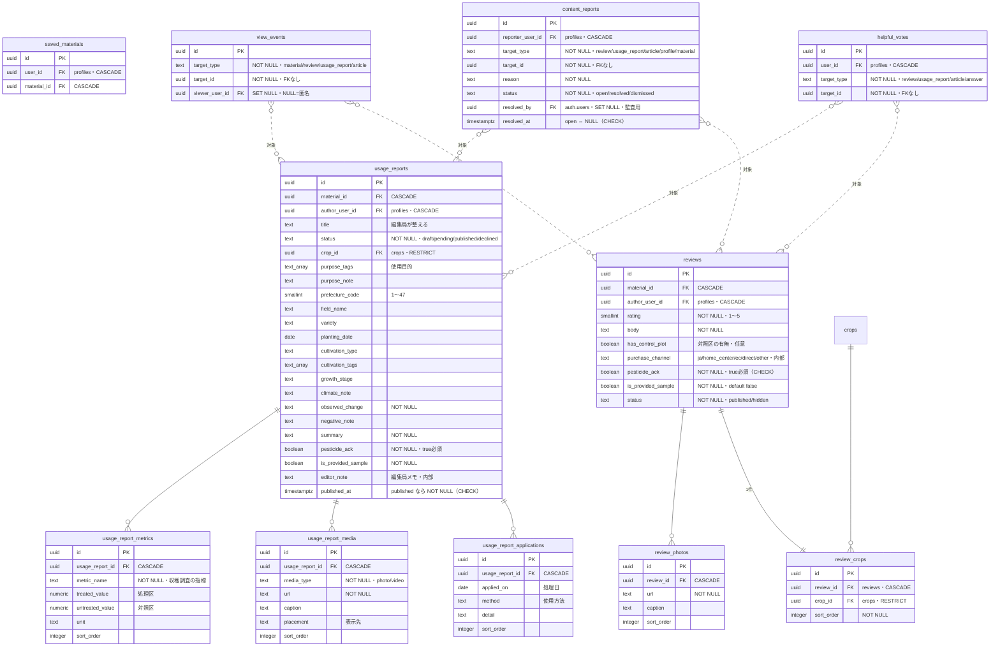

補足：`review_crops.review_id` は UNIQUEで、1レビューにつき作目を1件だけ保持する。遅延制約トリガーが0件も拒否する。`saved_materials` は `(user_id, material_id)` UNIQUE、`helpful_votes` は `(user_id, target_type, target_id)` UNIQUE。`view_events` は追記専用（UPDATE／DELETE 権限を剥奪）。`reviews` の INSERT／UPDATE／DELETE で集計トリガーが `materials.review_count`、`avg_rating`、`control_plot_ratio` を再計算する。

### 1.5 記事・Q&A（Phase 2 先行スキーマ）

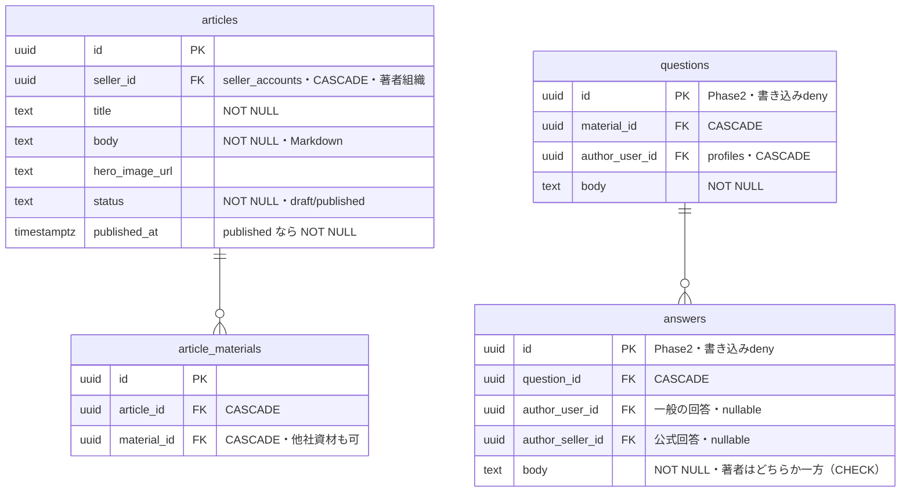

### 1.6 ビューと Storage（図外の公開面）

| ビュー | 権限 | 内容 |
|---|---|---|
| `public_profiles` | definer・SELECT のみ | profiles のハンドル・アバター・登録日時だけを返す |
| `public_sellers` | invoker＋列 GRANT | approved のメーカーのみ・contact_*／invite_code／rejected_reason を遮断 |
| `helpful_counts` | definer・SELECT のみ | helpful_votes の件数集計（個票は本人のみ） |
| `view_counts_daily` | definer・SELECT のみ | view_events の JST 日次集計（生ログは admin のみ） |

| Storage バケット | 上限 | 書き込み主体（パス先頭＝所有者） |
|---|---|---|
| avatars | 2MB | 一般本人 `{user_id}/…` |
| review-photos | 5MB | 一般本人 |
| report-media | 50MB（動画可） | 一般本人 |
| material-images | 5MB | メーカー `{seller_id}/…`・admin |
| article-images | 5MB | メーカー・admin |

---

## 2. シーケンス図

アクター表記：**ブラウザ**／**server**（Server Action＋src/server 層）／**Auth**（Supabase Auth）／**DB**（Postgres・RLS）／**Storage**。

### 2.1 一般ユーザー登録（補償処理付き）

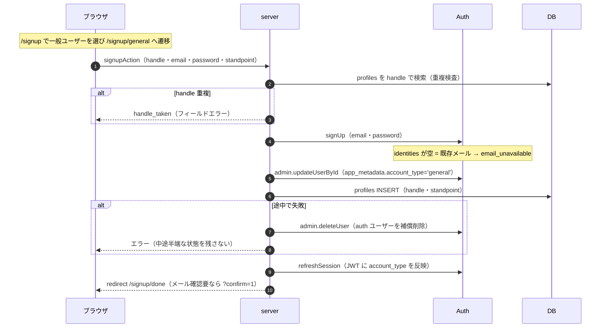

### 2.2 メーカーログイン（共有 ID・合成メール方式）

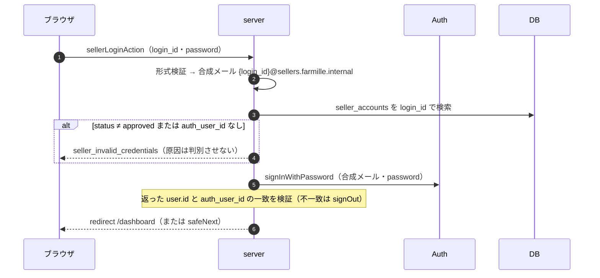

### 2.3 メーカー申請 → admin 承認

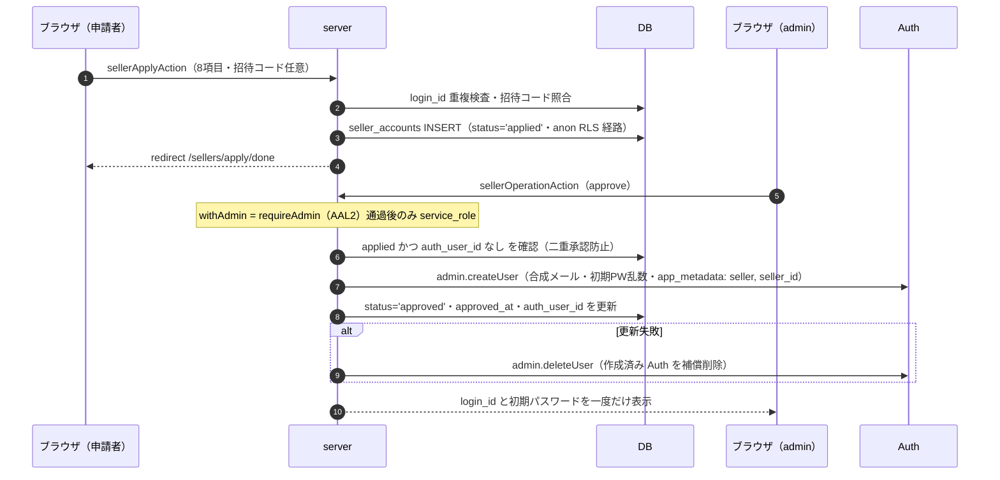

### 2.4 admin の AAL2（TOTP enroll → verify）

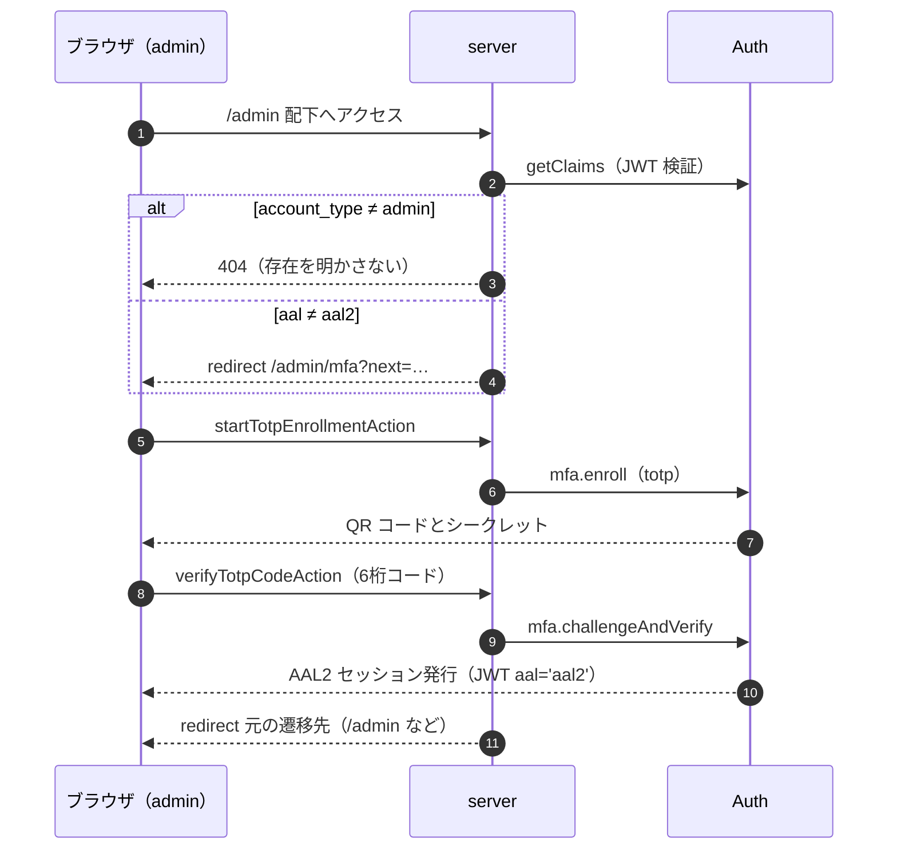

### 2.5 レビュー投稿（Storage 直アップロード＋集計トリガー）

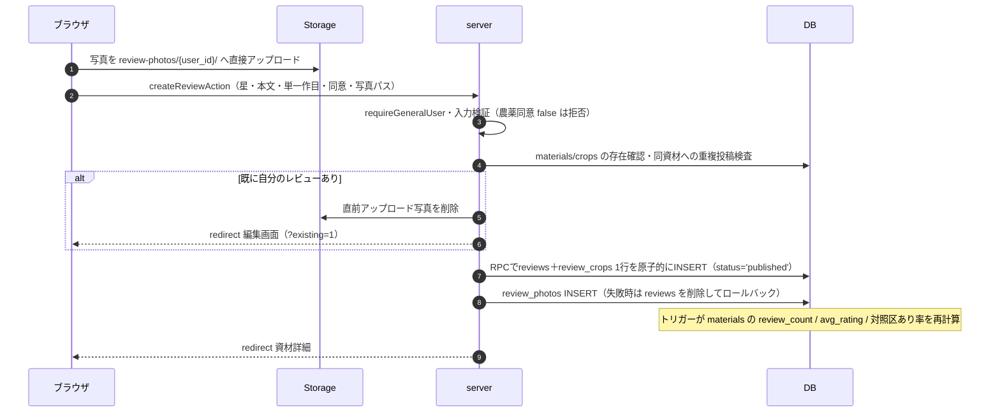

### 2.6 使用レポートのライフサイクル（編集局ワークフロー）

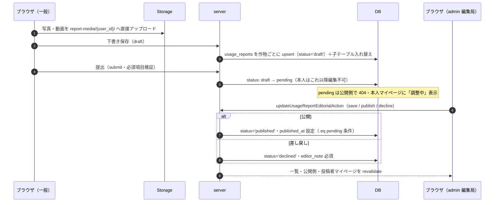

### 2.7 資材の共同管理（メーカー申請＋運営承認）

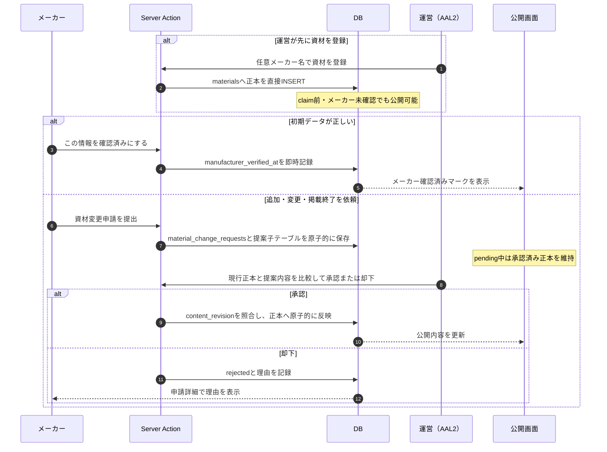

---

## 3. 主要導線の画面遷移図

凡例：実線＝リンク／リダイレクト。`login?next=` への誘導は「🔒」で略記（未ログイン時）。BottomNav（ホーム・探す・＋投稿・記事・マイページ）は公開＋一般側の全画面に共通なので個別エッジは省略。

認証とアカウント作成の分岐は、実画面スクリーンショットを使った [07-account-screen-flow.md](07-account-screen-flow.md) も併せて参照する。

### 3.1 公開＋一般ユーザー

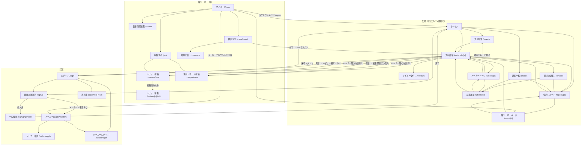

### 3.2 メーカー

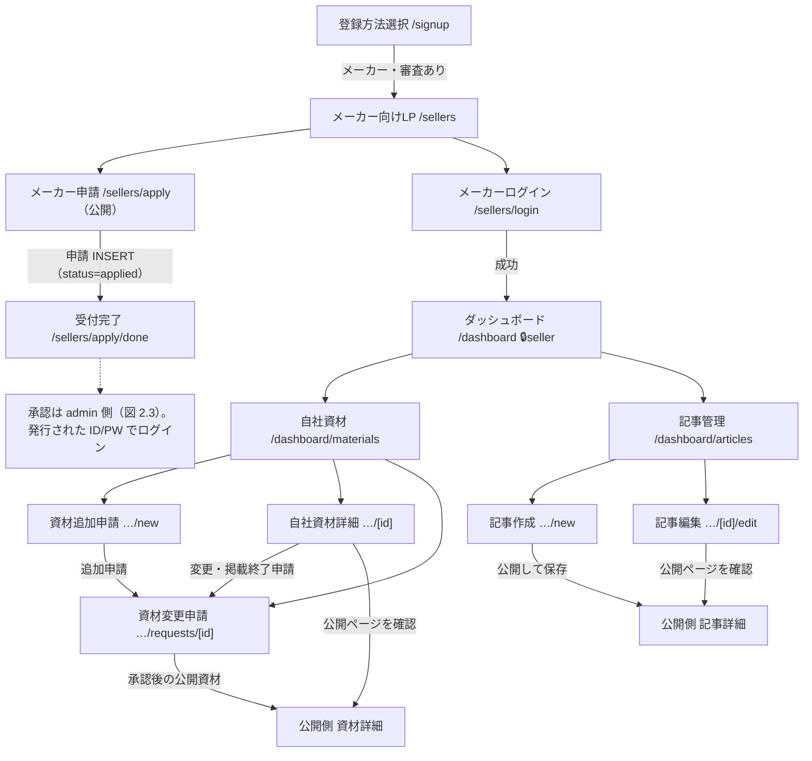

### 3.3 運営管理（admin・AAL2 必須）

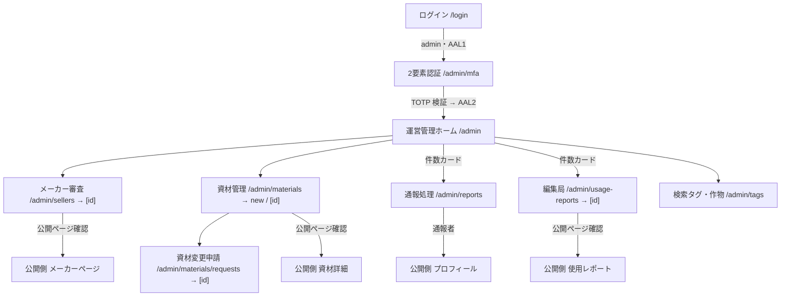

### 3.4 アクセス制御の要点（図の前提）

| 領域 | 一次防御 | 挙動 |
|---|---|---|
| `/signup` `/signup/general` | proxy | ログイン済み→`/`。一般登録とメーカー向けLPを入力前に分岐 |
| `/sellers` | 公開 | メーカー向けの対象条件・機能・承認フローを示し、申請またはログインへ分岐 |
| `/me` `/post` | proxy＋ページ内 | 未ログイン→`/login?next=`。メーカー・admin が開くと、URLを維持して各管理画面への案内を表示 |
| `/dashboard` | proxy＋`requireSeller` | 未ログイン→`/sellers/login?next=`。メーカー以外は画面内で拒否表示 |
| `/admin` | `requireAdminPage` | 未ログイン→`/login`。AAL1 の admin→`/admin/mfa`。admin 以外→**404**（存在を明かさない） |
| 通報・削除確認 | — | ページ遷移ではなくモーダル（`<dialog>`）。通報はレビュー・レポート・記事・プロフィールの4箇所 |

## 4. 全画面を含む実装ルート図

§3は主要タスクの読みやすさを優先した図である。本節は `src/app/**/page.tsx` を機械的に照合し、開発専用画面を含む全51画面をノードとして示す。矢印は画面内リンク、フォーム完了後のリダイレクト、または権限境界からの誘導を表す。共通ヘッダーと下部ナビから繰り返し到達する矢印は省略する。

### 4.1 公開・認証・一般ユーザー

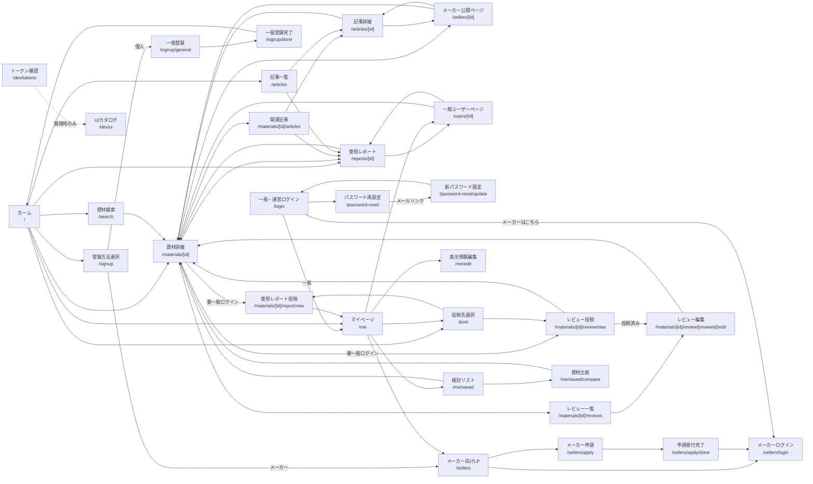

### 4.2 メーカー・運営

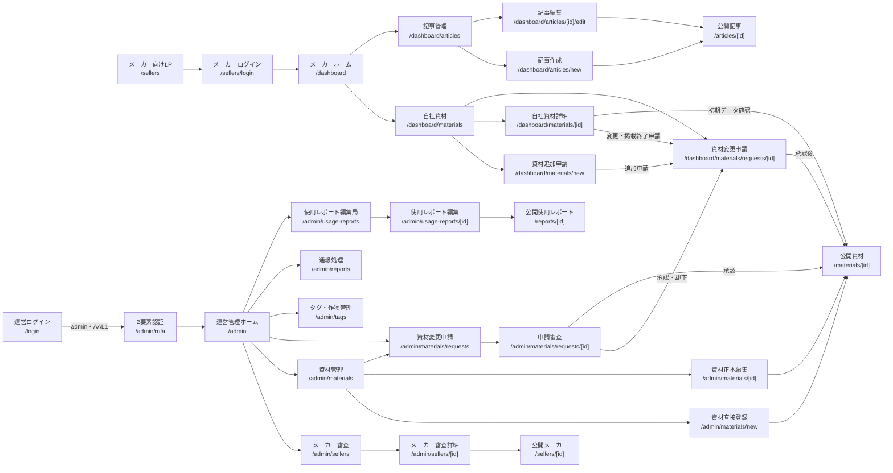

### 4.3 画面以外のApp Router入口

| 入口 | 種別 | 役割 |
|---|---|---|
| `/auth/confirm` | Route Handler | 一般ユーザーのメール確認後にセッションを確立して遷移 |
| `/logout` | Route Handler | セッション破棄後にホームへ遷移 |
| `/sitemap.xml` | メタデータルート | 公開対象の資材・記事・メーカー等を検索エンジンへ通知 |
| `/robots.txt` | メタデータルート | クロール方針を返す |
| `/opengraph-image` | メタデータルート | 共通OG画像を返す |
| `not-found.tsx`・`error.tsx` | 共通状態画面 | 404と取得失敗を、各領域で意味の伝わる日本語に分ける |
