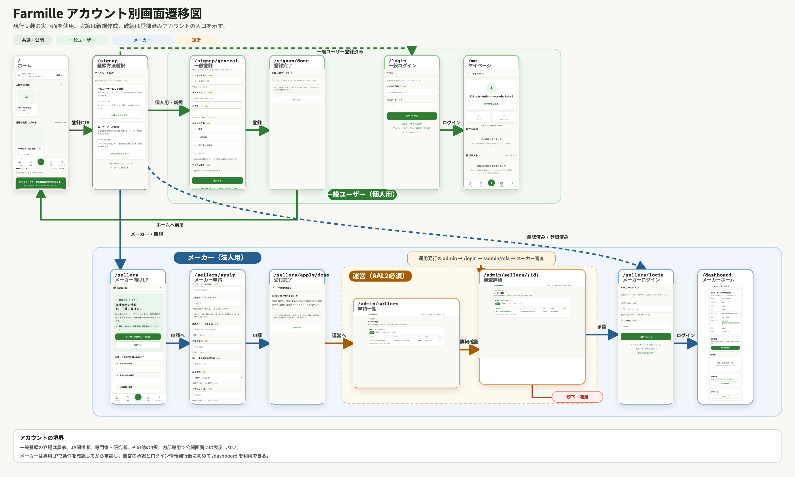
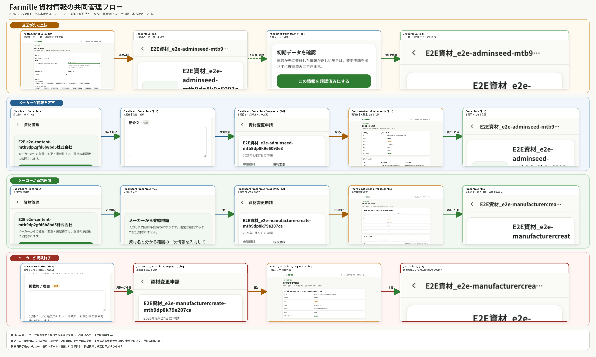

# 07 アカウント別画面遷移図

更新日：2026-09-05

一般ユーザーとメーカーの登録入口を分離した現行実装の画面遷移図。メーカーは専用LPで対象条件と承認フローを確認してから申請し、運営の審査とログイン情報の発行を経てメーカーダッシュボードへ進む。

拡大表示用：[PNG](assets/account-flow/account-screen-flow.png)／[SVG](assets/account-flow/account-screen-flow.svg)

一般ユーザーページはハンドル・アバター・投稿実績・投稿一覧だけで構成する。登録時に選んだ立場は内部属性として保持し、職業・地域・栽培情報・所属・一言・外部リンクと同様に公開しない。

## 資材情報の共同管理

運営による先行登録、メーカーによる初期データ確認・変更・新規追加・掲載終了、運営承認後の公開までを、ローカル本番ビルドの実画面で示す。

拡大表示用：[PNG](assets/account-flow/material-governance-screen-flow.png)／[SVG](assets/account-flow/material-governance-screen-flow.svg)

- 運営の直接登録は即時に正本へ反映される。メーカーの操作を待つ必要はない。
- メーカーによる追加・変更・掲載終了は承認待ち申請となり、運営承認後だけ正本へ反映される。
- メーカーが初期データを確認した時点、変更申請を提出した時点、または追加申請が承認された時点で、その資材に「メーカー確認済み」を表示する。
- 掲載終了は物理削除ではない。レビューと使用レポートを保持し、検索と新規投稿の対象から外す。

## 1. アカウント別の入口

| アカウント | 作成・申請 | ログイン | ログイン後 | 審査 |
|---|---|---|---|---|
| 一般ユーザー | `/signup` → `/signup/general` | `/login` | `/me` など | なし |
| メーカー | `/signup` → `/sellers` → `/sellers/apply` | `/sellers/login` | `/dashboard` | 運営の承認が必要 |
| 運営 | 運用で発行 | `/login` → `/admin/mfa` | `/admin` | AAL2 が必須 |

## 2. 分岐のルール

- `/signup` では、入力を始める前に一般ユーザー登録とメーカー申請を選ぶ。
- 一般登録ではハンドル・メール・パスワードに加え、立場を農家／JA関係者／専門家・研究者／その他から1件選ぶ。立場は公開しない。
- メーカー申請の前に専用LPを表示し、農業資材メーカーだけが対象であること、利用できる機能、運営承認を経て情報を公開することを示す。
- メーカー申請ではパスワードを受け付けない。運営が農業資材メーカーであることと申請内容を確認し、承認時に共有ログインを発行する。
- 申請が却下または凍結された場合は、メーカーログインへ進めない。
- 一般ユーザー、メーカー、運営でログイン入口とログイン後の画面を分ける。

## 3. スクリーンショットの範囲

登録方法選択、一般登録、一般登録完了、メーカー向けLP、メーカー申請、申請受付完了、一般ログイン、メーカーログインは、2026-09-05のローカル本番ビルドを375px幅で撮影した。メーカー審査一覧と審査詳細は同じビルドを1280px幅で撮影した。

資材情報の共同管理フローは2026-08-27のローカル本番ビルドを使用し、公開画面とメーカー画面を375px幅、運営画面を1280px幅で撮影した。スクリーンショットはE2E内で作成した資材を使い、初期確認、変更申請、追加申請、掲載終了申請と各承認結果を同じシナリオで検証している。

## 4. 全画面の網羅

`src/app/**/page.tsx` の全51画面を [06-diagrams.md](06-diagrams.md) §4 の完全ルート図へ反映した。公開・認証・一般ユーザーの図と、メーカー・運営の図に分け、動的詳細、編集、完了、パスワード再設定、開発専用画面も省略していない。画面を持たない認証確認・ログアウト・メタデータルートは同節の別表へ分離した。
