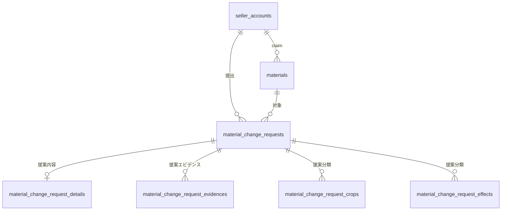
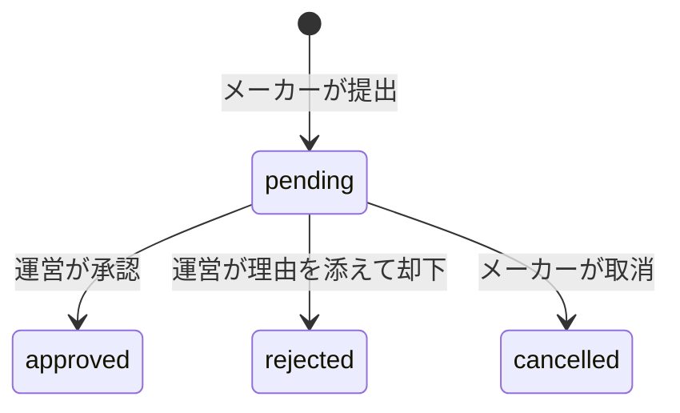

# 08 資材情報の共同管理 — OOUI 設計仕様

更新日：2026-09-04

本書は、メーカーと運営が同じ資材を扱いながら、公開情報の正確さと中立性を両立するための設計の正である。既存の資材モデルへ承認取引と確認状態を追加するため、OOUI のフル設計でモデル・ビュー・操作を再検証した。

## 1. スコープ

### 1.1 目的

- メーカーが自社資材を選び、情報の追加・変更・掲載終了を申し出られる。
- メーカーの変更は公開情報へ直接反映せず、運営が内容を確認して承認または却下できる。
- 運営はメーカーの操作を待たず、任意のメーカーの資材を正本へ直接登録・編集できる。
- メーカーが掲載内容へ関与した事実を、claim の有無と分けて「メーカー確認済み」として公開する。
- メーカーが掲載終了を希望しても、一般ユーザーのレビュー・使用レポートは消さない。

### 1.2 利用者

| 利用者 | 目的 | 主な関心対象 | 権限・制約 |
|---|---|---|---|
| メーカー | 自社資材の公開情報を正しく保つ | 自社資材、資材変更申請 | 自社資材だけを操作。公開反映には運営承認が必要 |
| 運営 | 資材情報の中立性と公開品質を保つ | 全資材、資材変更申請、メーカー | 資材正本を直接変更でき、申請を承認・却下する |
| 一般ユーザー | 情報の出所と確認状況を判断する | 公開資材 | 公開情報の閲覧のみ。メーカー確認状態を識別できる |

### 1.3 対象範囲

- 含む：資材の運営登録、メーカー追加申請、メーカー変更申請、掲載終了申請、承認・却下・取消、メーカー確認、エビデンス変更、公開マーク。
- 含まない：メーカーアカウント自体の審査、一般ユーザー投稿の審査、資材の物理削除、複数資材の一括承認。
- 既存領域との境界：記事は従来どおりメーカーが管理する。レビュー・使用レポートは資材が掲載終了しても存続する。

### 1.4 用語

| 採用語 | 意味 | 使用しない語 |
|---|---|---|
| 資材正本 | 公開画面が参照する、運営承認済みの資材情報 | メーカー下書き |
| 資材変更申請 | メーカーが提出した追加・変更・掲載終了の取引 | 編集データ、仮資材 |
| メーカー確認済み | 当該資材について、メーカー自身の確認または変更提出を記録済みの状態 | claim 済み、公式資材 |
| 掲載終了 | 一般ユーザーには資材を非公開にする可逆な状態。担当メーカーと運営は参照できる | 削除、完全削除 |

## 2. 根拠と判断

### 2.1 確認済みの事実

| 事実 | 確認元 | 設計への影響 |
|---|---|---|
| 資材はレビュー・使用レポート等のハブである | [01-domain-model.md](01-domain-model.md) | メーカーの削除を物理削除にしない |
| 分類・検索層は Farmille が所有する | [01-domain-model.md](01-domain-model.md) | メーカー入力も承認取引を介して正本へ反映する |
| 現行は `seller_id IS NOT NULL` を確認済み表示の条件にしている | 現行 migration・画面実装 | 所有関係と確認状態を分離する |
| 現行はメーカーの一次情報・エビデンス変更が即時公開される | 現行 RLS・Server Action | メーカーによる正本の直接更新権限を廃止する |

### 2.2 設計判断

| 論点 | 決定 | 根拠 | 見直す条件 |
|---|---|---|---|
| メーカーの削除 | 掲載終了申請として扱い、承認後も正本と投稿を保持する | 利用者投稿をメーカー都合で消さず、復元可能性を保つ | 法令に基づく完全消去が必要になった場合 |
| 確認済みの単位 | メーカー全体ではなく資材ごと | 1資材への関与だけで未確認の別資材まで確認済みにしない | 組織認証マークを別に導入する場合 |
| 確認済みになる操作 | 既存内容の確認、変更申請の提出、追加申請の承認 | メーカー本人の能動的な関与を根拠にする | 代理入力や複数メンバー権限を導入する場合 |
| claim の意味 | 自社資材として操作できる所有関係だけを表す | 操作権と情報確認を混同しない | claim 制度自体を廃止する場合 |
| 同時申請 | 同一資材の未処理申請は1件まで | 古い正本を基にした申請同士の競合を防ぐ | 変更単位別のマージUIを導入する場合 |
| メーカー名 | 既存資材は正本の表示名を維持し、新規申請はメーカー正式名称を初期値にする | 別ブランド名を勝手に上書きせず、なりすまし登録を防ぐ | ブランド・販売元を別オブジェクト化する場合 |

構造を左右する未解決事項はない。

## 3. タスク

| ID | 利用者 | 目的 | 対象 | 行為 | 結果 |
|---|---|---|---|---|---|
| M1 | メーカー | 自社資材を掲載する | 自社資材コレクション | 資材追加を申請 | 承認待ちの資材変更申請が作られる |
| M2 | メーカー | 公開情報を正しくする | 公開中の自社資材 | 情報変更を申請 | 正本は維持され、申請が承認待ちになる |
| M3 | メーカー | 不要な掲載を終える | 公開中の自社資材 | 掲載終了を申請 | 承認後に一般ユーザーへ非公開となる |
| M4 | メーカー | 初期データが正しいと示す | 運営登録済みの自社資材 | 掲載内容を確認する | 同じ資材へメーカー確認済み状態が反映される |
| M5 | メーカー | 提出内容と結果を把握する | 資材変更申請 | 申請を参照・取消 | 状態と運営コメントが同じ申請へ反映される |
| A1 | 運営 | メーカーの操作を待たず資材を掲載する | 全資材コレクション | 資材を直接登録 | 未確認の公開資材が作られる |
| A2 | 運営 | 申請内容を公開へ反映する | 資材変更申請 | 比較して承認 | 正本が原子的に更新される |
| A3 | 運営 | 不適切な変更を止める | 資材変更申請 | 理由を添えて却下 | 正本は変わらず、申請へ結果が残る |
| P1 | 一般ユーザー | 情報の確認元を判断する | 公開資材 | 確認状態を見る | メーカー関与済みの資材だけにマークが出る |

## 4. オブジェクトモデル

### 4.1 候補と判断

| 候補 | 利用者にとっての意味 | 分類 | 支持する証拠 | 反対証拠 | 判断 |
|---|---|---|---|---|---|
| 資材 | 公開情報と投稿が集まる製品 | メイン | 既存の全主要タスクの起点 | なし | 維持 |
| 資材変更申請 | 誰がいつ何を変えようとし、どう判断されたか | 付随する取引 | 提出者・状態・判断者・理由・取消がある | 単純な状態値でも表せる | 独立オブジェクトとして採用 |
| メーカー確認 | 資材情報へメーカーが関与した事実 | 資材の状態プロパティ | 公開マークと確認日時・方法が必要 | 一覧で個別に操作しない | 資材のプロパティとして採用 |
| claim | 資材とメーカーの所有関係 | 関係 | 操作権を決める | 公開確認の意味は持たない | `seller_id` の関係として維持 |
| 削除 | 掲載を終える行為 | アクション | メーカー要求に存在 | 投稿を含む独立対象ではない | 資材変更申請の「掲載終了」へ統合 |
| 承認 | 申請への判断 | アクション | 運営が実行する | 単独で探索しない | 資材変更申請のアクション |

### 4.2 オブジェクト定義

| オブジェクト | メイン／付随 | 同一性 | 主要プロパティ・状態 | アクション | 所有・権限 | 関係・多重性 |
|---|---|---|---|---|---|---|
| 資材 | メイン | 資材ID、資材名、メーカー名 | 公開情報、分類、掲載状態、内容版、メーカー確認日時・方法 | 運営登録・直接編集・復元、メーカー確認 | 正本は運営。メーカーは claim 済み自社資材を参照 | メーカー0..1、変更申請0..多、投稿0..多 |
| 資材変更申請 | 付随する取引 | 申請ID、提出日時 | 種別、提案スナップショット、承認状態、基準版、判断者・日時・理由 | 提出、取消、承認、却下 | 提出メーカーと運営だけが参照 | メーカー1、対象資材0..1、結果資材0..1 |
| エビデンス | 付随 | エビデンスID | 種類、タイトル、参照先、順序 | 追加・除外を変更申請へ含める | 正本は運営承認後に更新 | 資材1、変更申請スナップショット0..多 |
| メーカー | メイン | メーカーID、正式名称 | 審査状態 | 自社資材を選ぶ、追加を始める | 承認済みメーカーだけが申請可能 | 資材0..多、変更申請0..多 |

### 4.3 状態遷移

資材は `published` から、掲載終了申請の承認で `archived` へ進む。運営は誤操作や再掲載に対応するため `archived` を `published` へ復元できる。

## 5. ビューとナビゲーション

### 5.1 オブジェクト／ビュー対応

| オブジェクト | コレクション | シングル | 別表現 | 呼び出し元／先 | ルート | 理由 |
|---|---|---|---|---|---|---|
| 資材 | `/dashboard/materials`、`/admin/materials`、公開検索 | `/dashboard/materials/[id]`、`/admin/materials/[id]`、公開詳細 | 利用者別に表示プロパティと操作を変える同一対象 | コレクション→資材、資材→変更申請 | メーカーナビの「資材」、運営ナビの「資材」 | メーカー・運営とも反復作業の安定した起点になる |
| 資材変更申請 | 資材コレクション内の関連一覧、`/admin/materials/requests` | メーカー・運営それぞれの申請詳細 | 運営詳細は正本との比較表現 | 資材→申請、申請→対象／結果資材 | 単独ルートには置かない | 常に資材管理の文脈で扱う付随取引だから |
| エビデンス | 資材シングル内の関連コレクション | 独立シングルなし | 変更申請詳細で現行／提案を比較 | 資材→エビデンス | なし | 親資材を離れて探すタスクがない |

### 5.2 追加・更新するルート

| ルート | 表象する対象 | 主な操作 |
|---|---|---|
| `/dashboard/materials` | 自社資材コレクション＋関連する変更申請 | 資材選択、追加開始、申請選択 |
| `/dashboard/materials/new` | 自社資材コレクションへの作成サーフェス | 追加申請を提出 |
| `/dashboard/materials/[id]` | 自社資材シングル | 変更申請、確認、掲載終了申請、エビデンス変更 |
| `/dashboard/materials/requests/[id]` | 自社の資材変更申請シングル | 提案内容・状態・運営コメントの参照、取消 |
| `/admin/materials/requests` | 資材変更申請コレクション | 状態・種別で絞り込み、対象選択 |
| `/admin/materials/requests/[id]` | 資材変更申請シングル | 正本比較、承認、却下 |

メーカーPCナビには「資材」を追加する。モバイルでは各画面の戻り先を `/dashboard/materials` に統一する。申請作成後は申請シングルへ着地し、対象と現在状態をその場で確認できる。

## 6. UI 棚卸しとレイアウト

### 6.1 体験目標

- 快：メーカーは「いま公開中の内容」と「運営確認中の内容」を取り違えず、次に何を待つか分かる。
- 快：運営は申請単位で現行と提案を比較し、対象を見失わず判断できる。
- 不快：保存した瞬間に公開されたように見える、claim だけで確認済みと誤認する、削除で利用者投稿まで消える。

### 6.2 パターン棚卸し

| レイヤー | 候補 | 採否と理由 |
|---|---|---|
| L1 表示 | 資材カード＋状態バッジ、申請カード、現行／提案の比較 | 採用。対象と取引を別の境界で知覚させる |
| L1 表示 | CRUDテーブルだけで全操作 | 不採用。資材と申請の関係、確認状態が埋もれる |
| L2 操作 | 資材選択後に変更・確認・掲載終了 | 採用。名詞→動詞の順序を保つ |
| L2 操作 | 追加・編集・削除を別のルートメニューへ並べる | 不採用。同じ資材コレクションがタスクごとに分裂する |
| L3 ロジック | 正本と提案スナップショット、内容版による競合検知 | 採用。審査中に正本が変わった申請を誤適用しない |
| L4 信頼 | claim とメーカー確認済みを別状態にする | 採用。所有権を出所確認の代用にしない |
| L5 境界 | メーカーは申請だけを書き、正本反映は承認RPCで原子的に行う | 採用。アプリ認可とDB認可の二層で直接更新を防ぐ |

### 6.3 情報の優先順位

- 一等地：資材名、メーカー名、掲載状態、メーカー確認状態、未処理申請の有無。
- 常時表示の補助：申請種別、提出日、承認状態、運営コメント。
- 必要な人だけ見る：全分類、全一次情報、エビデンス差分、内容版。
- 非表示：内部ID、DBカラム名、claim を確認済みの代替として見せる表現。

### 6.4 UIスタック

| 状態 | メーカー資材コレクション | 資材シングル | 申請シングル |
|---|---|---|---|
| 通常 | 掲載中・掲載終了と申請を区別 | 公開正本と可能な操作を表示 | 提案、対象、状態、次の行動を表示 |
| 空 | 「最初の資材を追加」へ誘導 | 該当なし | 該当なし |
| 部分 | 画像・評価なしでも名称と状態を維持 | 任意情報は「未登録」 | 現行資材がない追加申請も提案を表示 |
| 読み込み | Server Component の画面遷移として既存ローディングを使用 | 同左 | 同左 |
| エラー | 再読込とダッシュボードへの退避 | 資材一覧への回復 | 一覧への回復、入力済み内容を失わない |
| 処理中 | 送信ボタンを対象フォーム内で処理中表示 | 同左 | 承認・却下・取消の作用先付近で表示 |
| 権限差 | 他社資材は存在を明かさず404 | 同左 | 他社申請は404 |
| 競合 | 未処理申請ありをカードへ表示 | 新規申請を止め、既存申請へ誘導 | 運営へ内容版不一致を示し、再提出へ戻す |

## 7. アクション契約

| アクション | 対象・スコープ | 前提 | 結果・反映先 | 失敗・回復 | 可逆性 |
|---|---|---|---|---|---|
| 資材追加を申請 | 自社資材コレクション | 承認済みメーカー、必須項目 | `pending` 申請を作成し申請詳細へ | 重複名は承認時に競合表示 | pending 中は取消可 |
| 資材変更を申請 | 選択した自社資材1件 | claim 済み、未処理申請なし | 正本を変えずスナップショットを保存。資材へ確認済みを反映 | 内容版競合時は適用せず再提出 | pending 中は取消可 |
| 掲載内容を確認 | 選択した自社資材1件 | claim 済み | 資材へ確認日時・方法を即時反映 | 再実行は同じ確認状態を更新 | 運営がclaim解除時に確認状態も解除 |
| 掲載終了を申請 | 選択した自社資材1件 | 公開中、未処理申請なし | pending 申請を作成 | 承認までは公開継続 | pending 中は取消可、承認後は運営が復元可 |
| 申請を承認 | 選択した申請1件 | admin＋AAL2、pending、内容版一致 | 正本・分類・エビデンスを1トランザクションで反映 | 競合時は正本を変えず申請を保持 | 運営が正本を再編集・掲載復元可 |
| 申請を却下 | 選択した申請1件 | admin＋AAL2、pending、理由必須 | rejected と判断情報を申請へ反映 | 再読込後に再試行 | 正本は変化しない |

## 8. タスク追跡と4原則レビュー

| タスク | 起点 | 対象の発見と選択 | アクション | 結果と反映先 | 判定 |
|---|---|---|---|---|---|
| M1 | メーカーナビ「資材」 | 自社資材コレクション | 「資材を追加」→提出 | 申請詳細と一覧 | 充足 |
| M2・M3・M4 | 自社資材コレクション | 資材カード→資材シングル | 変更・掲載終了・確認 | 同じ資材と関連申請 | 充足 |
| M5 | 資材シングル／コレクション | 申請カード | 参照・取消 | 同じ申請 | 充足 |
| A1 | 運営ナビ「資材」 | 全資材コレクション | 新規登録 | 資材シングル | 充足 |
| A2・A3 | 運営の資材変更申請 | 申請カード→申請シングル | 承認・却下 | 申請と資材正本 | 充足 |
| P1 | 公開検索・資材詳細 | 資材カード／シングル | 状態を読む | 同じ資材 | 充足 |

| 原則 | 充足状況 | 具体的な根拠 |
|---|---|---|
| 対象を知覚し直接働きかけられる | 充足 | 資材を選んだ後、その資材の変更・確認・掲載終了を選ぶ |
| プロパティと状態が対象に表れる | 充足 | 掲載状態・メーカー確認・未処理申請を資材カードとシングルへ同期表示 |
| 対象選択からアクション選択へ進む | 充足 | 既存資材の操作をダッシュボード上の動詞メニューへ分裂させない |
| オブジェクトが関係を保って協調する | 充足 | 申請から対象／結果資材へ戻れ、資材から申請履歴を辿れる |

タスク指向の例外は新規資材フォームだけである。作成前は選択できる資材が存在しないため、メーカーの自社資材コレクションを作成先として開始し、提出後は作成された申請シングルへ着地する。

## 9. 最終ゲート

| 最終ゲート項目 | 判定 | 根拠 |
|---|---|---|
| モデル・ビュー・レイアウトの語彙が一致する | PASS | 資材正本、資材変更申請、メーカー確認済みに統一 |
| 同一性・状態・関係・アクションが説明されている | PASS | §4 と §7 |
| 主要ビューと入口に採用理由がある | PASS | §5 |
| 全主要タスクに行き止まりがない | PASS | §8 |
| OOUIの4原則に具体的根拠がある | PASS | §8 |
| 権限差・対象不在・競合・取消を扱う | PASS | §6・§7 |
| 反証パスを通過する | PASS | claimだけの誤表示、物理削除、役割別の資材複製、同時申請を退けた |
| 構造を左右する未解決事項がない | PASS | §2.2 を設計判断として確定 |

総合判定：**PASS**
