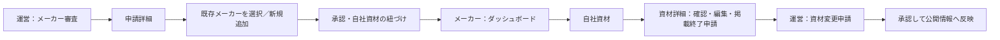

# メーカー審査と資材の紐づけ

## 対象と関係

運営はメーカーアカウントの申請を選び、資材マスタに登録されたメーカーを指定して承認する。該当メーカーがない場合は名称を入力して追加する。

| 対象 | 同一性・状態 | 関係と操作 |
| --- | --- | --- |
| メーカー | マスタ上の名称 | 複数の資材を持ち、最大1つのアカウントに紐づく。運営が追加する |
| メーカーアカウント | 申請ID・ログインID・審査状態 | 承認時に1メーカーを選択する。運営が承認・却下・凍結する |
| 資材 | 資材ID・名称・公開状態 | メーカーを参照し、個別のclaimで操作権限を持つ。メーカーは確認・変更申請・掲載終了申請を行う |
| 資材変更申請 | 申請ID・対象資材・審査状態 | 運営の承認後に資材正本へ反映する |

メーカー名は候補を選択する対象であるため、単なる自由記述からメーカーの参照にする。独立したメーカー編集ページは作らず、申請詳細の関連対象として表示する。claimは個別資材への権限付与で、メーカーの所属とは区別する。運営による既存の個別解除・付け替えを保持する。

## 操作と状態

- 運営の申請詳細に、メーカーの選択欄と新規メーカー名の入力欄を置く。
- 承認・メーカー作成・紐づけ・既存資材のclaim付与はDB内の1トランザクションで反映する。
- 別アカウントに紐づくメーカー、別アカウントがclaim済みの資材がある場合は競合として停止し、既存権限を上書きしない。
- 審査中の未入力、存在しないメーカー、新規名称の重複を拒否する。エラー時は入力内容を保持する。
- 承認後に運営が追加する同メーカーの資材にもclaimを付与する。メーカーによる情報確認前は確認済みマークを付けない。
- 凍結中は既存の認証・RLS・変更申請ガードが操作を拒否する。

## ビューとタスク経路

一般ユーザーは公開資材を閲覧し、レビュー・使用レポート・保存を利用する。メーカーと運営は既存の一覧・詳細を入口にする。

## 設計検証

申請詳細でメーカーを識別してから承認する。資材の名称・公開状態・申請状態は既存の資材一覧と詳細に表示する。変更後も同じ資材IDを参照し、メーカーと運営の申請詳細から対象資材へ戻れる。モバイルでも同じ選択と操作を縦に配置する。承認時のアカウント発行は認証の前提を整える補助操作として、申請詳細内で完結する。

重複承認、メーカー重複、他社資材へのアクセス、追加後の資材取得を検証対象とする。一般・メーカー・運営の実画面と遷移は07の資料へ記録する。
