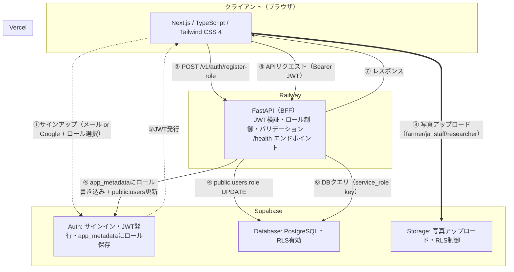

# Farmille v1 初期環境構築 — Claude Code 完全指示書

**作成日**: 2026-04-17
**対象**: GitHub リポジトリ `farmille`（ほぼ空の状態。`.claude/settings.local.json` のみ存在）
**実行環境**: macOS (Apple Silicon)
**目標**: この指示書に従ってプロジェクトを初期構築し、`make setup && make dev` でフロント・バックエンドが同時に起動する状態にすること

---

## 0. このドキュメントの読み方

**あなた（Claude Code）は、この指示書に書かれた内容をそのまま実行してください。**
- 「なぜ」の説明はあなたの判断の精度を上げるために書いてあります。実装時は「何を」に集中してください
- 別途渡される `init.sql` と `seed.sql` はDB定義とマスタデータです。`supabase/migrations/` にコピーしてください
- 各Phase完了時に進捗を報告してください
- 不明点があれば実装前に質問してください。推測で進めないでください

---

## 1. プロジェクト概要

Farmille は BS資材（生物・微生物農業資材）の農家レビュープラットフォーム。
農家がBS資材の使用感をレビューとして投稿し、メーカーが資材情報を登録する。

### 技術スタック
| レイヤー | 技術 | デプロイ先 |
|----------|------|-----------|
| フロントエンド | Next.js 15 / TypeScript / Tailwind CSS 4 | Vercel |
| バックエンド（BFF） | FastAPI / Python 3.12 | Railway |
| DB / Auth / Storage | Supabase (PostgreSQL) | Supabase |
| Pythonパッケージ管理 | uv | — |

### アーキテクチャ
```
ブラウザ → Next.js (Vercel)
             ↓ APIリクエスト（Bearer JWT）
           FastAPI (Railway) ← BFF: JWT検証・ロール制御・ビジネスロジック
             ↓ service_role key
           Supabase (PostgreSQL + Auth + Storage)
```

**原則：全てのビジネスロジックはFastAPIを経由する。**
例外は2つだけ：
1. 認証（Supabase Auth に直接アクセス）
2. 写真アップロード（Supabase Storage に直接アクセス、RLSで制御）

### 4ロール権限体系
| ロール | できること |
|--------|-----------|
| `farmer` | レビュー投稿・写真アップロード |
| `ja_staff` | レビュー投稿・写真アップロード（将来JA用ダッシュボード） |
| `researcher` | レビュー投稿・写真アップロード |
| `maker` | 資材登録・自社資材管理 |
| `unassigned` | オンボーディング未完了（登録直後のデフォルト） |

### 認証・ロール付与フロー
```
1. ユーザーがSupabase Authでアカウント作成（メール or Google）
2. DBトリガー（handle_new_user）が発火 → public.users に role='unassigned' で自動INSERT
3. オンボーディング画面でロール選択（4択ラジオボタン）
4. Next.js が FastAPI に POST /v1/auth/register-role { role: "farmer" } を送信
5. FastAPI が：
   a. JWTで本人確認
   b. auth.users.app_metadata.role に書き込み（Supabase Admin権限）
   c. public.users.role を UPDATE
   d. 両方成功して初めてレスポンス返却
6. 以降の全リクエストで app_metadata.role を参照して権限判定
```

---

## 2. ディレクトリ構成（最終形）

**以下の構成を正確に作成すること。**

```
farmille/
├── .claude/
│   └── settings.local.json          # 既存（触らない）
├── frontend/
│   ├── app/
│   │   ├── api/
│   │   │   └── cron/
│   │   │       └── keep-alive/
│   │   │           └── route.ts
│   │   ├── layout.tsx
│   │   └── page.tsx
│   ├── src/
│   │   ├── lib/
│   │   │   └── supabase/
│   │   │       ├── client.ts
│   │   │       └── server.ts
│   │   └── types/
│   │       └── database.types.ts    # 空ファイル（gen:typesで生成）
│   ├── .env.example
│   ├── next.config.ts
│   ├── package.json
│   ├── tsconfig.json
│   ├── tailwind.config.ts           # Tailwind v4の場合は不要かも
│   └── vercel.json
├── backend/
│   ├── app/
│   │   ├── __init__.py
│   │   ├── main.py
│   │   ├── config.py
│   │   ├── dependencies.py
│   │   ├── auth/
│   │   │   ├── __init__.py
│   │   │   ├── jwt.py
│   │   │   └── roles.py
│   │   ├── routers/
│   │   │   ├── __init__.py
│   │   │   ├── auth.py
│   │   │   ├── health.py
│   │   │   ├── products.py
│   │   │   └── reviews.py
│   │   ├── models/
│   │   │   ├── __init__.py
│   │   │   └── schemas.py
│   │   └── services/
│   │       ├── __init__.py
│   │       └── supabase.py
│   ├── .env.example
│   ├── .python-version
│   ├── Dockerfile
│   ├── pyproject.toml
│   └── railway.toml
├── supabase/
│   └── migrations/
│       ├── 20260415000000_farmille_init.sql   # 別途渡すファイルをここにコピー
│       └── 20260415000001_farmille_seed.sql   # 別途渡すファイルをここにコピー
├── docs/
│   ├── README.md                # ドキュメント一覧（外部リンク含む）
│   ├── architecture.md          # アーキテクチャ設計
│   ├── database.md              # DB設計の思想と判断根拠
│   └── decisions/
│       ├── README.md
│       └── 0001-railway-adoption.md
├── .gitignore
├── CLAUDE.md
├── Makefile
└── README.md
```

---

## 3. 各ファイルの実装仕様

### 3.1 プロジェクトルート

#### `.gitignore`
```gitignore
# Python
__pycache__/
*.py[cod]
*.egg-info/
.venv/
.uv/

# Node
node_modules/
.next/
out/

# 環境変数
.env
.env.local
.env.*.local

# IDE
.vscode/
.idea/
*.swp
*.swo

# OS
.DS_Store
Thumbs.db

# Supabase
supabase/.temp/
```

#### `Makefile`
```makefile
.PHONY: setup dev stop

setup:
	cd frontend && pnpm install
	cd backend && uv sync

dev:
	@echo "Starting backend and frontend..."
	cd backend && uv run uvicorn app.main:app --reload --port 8000 &
	cd frontend && pnpm dev

stop:
	@lsof -ti:8000 | xargs kill -9 2>/dev/null || true
	@lsof -ti:3000 | xargs kill -9 2>/dev/null || true
	@echo "Stopped all dev servers."
```

#### `CLAUDE.md`
```markdown
# Farmille プロジェクト方針

## このプロジェクトについて
BS資材（生物・微生物農業資材）の農家レビュープラットフォーム。
ターゲット：農家・JA普及員・農学者・メーカー。

## 技術スタック
- Frontend: Next.js 15 / TypeScript / Tailwind CSS 4 / Vercel
- Backend: FastAPI / Python 3.12 / uv / Railway
- DB/Auth/Storage: Supabase (PostgreSQL)

## 設計哲学（最重要）
**DOA（Data-Oriented Architecture）を最優先する。**
- データモデルは技術負債を一切作らない
- 正規化・スケーラビリティを妥協しない
- UIはバイブコーディングで爆速。ただしデータ設計の決定を覆すUIは作らない

## コーディング規約
- Railway固有の環境変数（`RAILWAY_*`）をコード上で参照しない
- DBスキーマ変更後は `pnpm gen:types` で型を再生成する
- 環境変数は `pydantic-settings` (backend) / `process.env` (frontend) 経由で読む
- 認証チェックは BFF（FastAPI）で第一防御、RLSで第二防御

## 4ロール権限体系
- `farmer`: レビュー投稿・写真アップロード
- `ja_staff`: レビュー投稿・写真アップロード（将来JA用ダッシュボード）
- `researcher`: レビュー投稿・写真アップロード
- `maker`: 資材登録・自社資材管理
- `unassigned`: オンボーディング未完了（登録直後のデフォルト）

## ディレクトリ規約
- `frontend/` : Next.js（Vercelデプロイ）
- `backend/` : FastAPI（Railwayデプロイ）
- `supabase/migrations/` : DBマイグレーション
- `docs/decisions/` : ADR（アーキテクチャ意思決定記録）

## 重要な意思決定はADRを参照
`docs/decisions/` 配下のドキュメントを参照すること。
```

#### `README.md`
```markdown
# Farmille

BS資材（生物・微生物農業資材）の農家レビュープラットフォーム

## 技術スタック

- **Frontend**: Next.js 15 / TypeScript / Tailwind CSS 4
- **Backend**: FastAPI / Python 3.12
- **DB/Auth/Storage**: Supabase (PostgreSQL)
- **Deploy**: Vercel (frontend) / Railway (backend)

## セットアップ

### 前提条件
- Node.js 22+
- pnpm 10+
- Python 3.12+
- uv
- Docker（バックエンドのビルド確認用）

### 手順

1. リポジトリをクローン
   ```bash
   git clone https://github.com/farmille/farmille.git
   cd farmille
   ```

2. 環境変数を設定
   ```bash
   cp frontend/.env.example frontend/.env.local
   cp backend/.env.example backend/.env
   # 各ファイルに実際の値を設定（SlackでSupabase認証情報を受け取る）
   ```

3. 依存関係インストール＆起動
   ```bash
   make setup
   make dev
   ```

4. 確認
   - フロントエンド: http://localhost:3000
   - FastAPI Docs: http://localhost:8000/docs
   - ヘルスチェック: http://localhost:8000/health

## 開発フロー

### DBスキーマ変更時
1. `supabase/migrations/` に新しいマイグレーションファイルを追加
2. `supabase db push` で farmille-dev に適用
3. `cd frontend && pnpm gen:types` で型を再生成
4. 型ファイルの差分をコミット

### 環境変数変更時
1. `.env.example` を更新（git管理）
2. ローカルの `.env` / `.env.local` も手動で更新
3. 本番環境変数はRailway/Vercelダッシュボードで更新

### デプロイ
- フロント: `main` ブランチへのpushで自動デプロイ（Vercel）
- バック: `main` ブランチへのpushで自動デプロイ（Railway）

## Supabase Storage 設定（手動）

Supabaseダッシュボードで以下を設定すること：

1. Storage → New Bucket → `review-images` を作成（Public bucket）
2. バケット設定:
   - ファイルサイズ上限: 5MB
   - 許可するMIMEタイプ: `image/jpeg`, `image/png`, `image/webp`
3. RLSポリシー:
   - アップロード: `app_metadata.role IN ('farmer', 'ja_staff', 'researcher')`
   - 閲覧: 全員（`anon` + `authenticated`）

## トラブルシューティング

### Railwayでビルドが失敗する
1. ローカルで `docker build -t farmille-backend ./backend` が通るか確認
2. `railway.toml` の `builder = "DOCKERFILE"` が指定されているか確認

### 型エラーが出る
1. `cd frontend && pnpm gen:types` でDB型を最新化
2. それでも解消しない場合はマイグレーションファイルを確認

### dev サーバーが停止しない
```bash
make stop
```
```

---

### 3.2 バックエンド (`backend/`)

#### `backend/.python-version`
```
3.12
```

#### `backend/pyproject.toml`
```toml
[project]
name = "farmille-backend"
version = "0.1.0"
description = "Farmille v1 Backend (FastAPI BFF)"
requires-python = ">=3.12"
dependencies = [
    "fastapi>=0.115.0",
    "uvicorn[standard]>=0.30.0",
    "pydantic-settings>=2.0.0",
    "python-jose[cryptography]>=3.3.0",
    "httpx>=0.27.0",
    "supabase>=2.0.0",
]

[tool.uv]
dev-dependencies = [
    "ruff>=0.6.0",
    "mypy>=1.11.0",
    "pytest>=8.0.0",
]
```

#### `backend/.env.example`
```env
# Supabase
SUPABASE_URL=https://your-project.supabase.co
SUPABASE_SERVICE_ROLE_KEY=your-service-role-key
SUPABASE_JWT_SECRET=your-jwt-secret

# App
CORS_ORIGINS=http://localhost:3000
ENVIRONMENT=development
```

#### `backend/app/__init__.py`
空ファイル

#### `backend/app/config.py`
```python
from pydantic_settings import BaseSettings


class Settings(BaseSettings):
    supabase_url: str
    supabase_service_role_key: str
    supabase_jwt_secret: str
    cors_origins: str = "http://localhost:3000"
    environment: str = "development"

    model_config = {"env_file": ".env"}


settings = Settings()
```

#### `backend/app/main.py`
```python
from fastapi import FastAPI
from fastapi.middleware.cors import CORSMiddleware

from app.config import settings
from app.routers import auth, health, products, reviews

app = FastAPI(
    title="Farmille API",
    version="0.1.0",
    docs_url="/docs" if settings.environment == "development" else None,
)

app.add_middleware(
    CORSMiddleware,
    allow_origins=settings.cors_origins.split(","),
    allow_credentials=True,
    allow_methods=["*"],
    allow_headers=["*"],
)

app.include_router(health.router)
app.include_router(auth.router, prefix="/v1/auth", tags=["auth"])
app.include_router(products.router, prefix="/v1/products", tags=["products"])
app.include_router(reviews.router, prefix="/v1/reviews", tags=["reviews"])
```

#### `backend/app/dependencies.py`
```python
from fastapi import Depends, HTTPException, status
from fastapi.security import HTTPAuthorizationCredentials, HTTPBearer

from app.auth.jwt import verify_jwt
from app.auth.roles import RoleChecker

security = HTTPBearer()


async def get_current_user(
    credentials: HTTPAuthorizationCredentials = Depends(security),
) -> dict:
    """JWTを検証し、ユーザー情報を返す。"""
    payload = verify_jwt(credentials.credentials)
    if payload is None:
        raise HTTPException(
            status_code=status.HTTP_401_UNAUTHORIZED,
            detail="Invalid or expired token",
        )
    return payload


def require_role(*allowed_roles: str):
    """指定ロールのみアクセス可能にするDependency。"""
    checker = RoleChecker(allowed_roles)
    return Depends(checker)
```

#### `backend/app/auth/__init__.py`
空ファイル

#### `backend/app/auth/jwt.py`
```python
from jose import JWTError, jwt

from app.config import settings


def verify_jwt(token: str) -> dict | None:
    """Supabase JWTの署名を検証し、payloadを返す。"""
    try:
        payload = jwt.decode(
            token,
            settings.supabase_jwt_secret,
            algorithms=["HS256"],
            audience="authenticated",
        )
        return payload
    except JWTError:
        return None


def get_user_id(payload: dict) -> str:
    """JWTペイロードからユーザーIDを取得。"""
    return payload.get("sub", "")


def get_user_role(payload: dict) -> str:
    """JWTペイロードからロールを取得。"""
    app_metadata = payload.get("app_metadata", {})
    return app_metadata.get("role", "unassigned")
```

#### `backend/app/auth/roles.py`
```python
from fastapi import Depends, HTTPException, status

from app.dependencies import get_current_user
from app.auth.jwt import get_user_role


class RoleChecker:
    """ロールベースのアクセス制御。"""

    def __init__(self, allowed_roles: tuple[str, ...]):
        self.allowed_roles = allowed_roles

    def __call__(self, user: dict = Depends(get_current_user)) -> dict:
        role = get_user_role(user)
        if role not in self.allowed_roles:
            raise HTTPException(
                status_code=status.HTTP_403_FORBIDDEN,
                detail=f"Role '{role}' is not allowed. Required: {self.allowed_roles}",
            )
        return user
```

#### `backend/app/routers/__init__.py`
空ファイル

#### `backend/app/routers/health.py`
```python
from fastapi import APIRouter

router = APIRouter()


@router.get("/health")
async def health_check():
    return {"status": "ok"}
```

#### `backend/app/routers/auth.py`
```python
from fastapi import APIRouter, Depends, HTTPException, status
from pydantic import BaseModel

from app.auth.jwt import get_user_id, get_user_role
from app.dependencies import get_current_user
from app.services.supabase import get_supabase_admin

router = APIRouter()

VALID_ROLES = {"farmer", "maker", "ja_staff", "researcher"}


class RegisterRoleRequest(BaseModel):
    role: str


@router.post("/register-role")
async def register_role(
    body: RegisterRoleRequest,
    user: dict = Depends(get_current_user),
):
    """オンボーディング時にロールを付与する。"""
    if body.role not in VALID_ROLES:
        raise HTTPException(
            status_code=status.HTTP_400_BAD_REQUEST,
            detail=f"Invalid role. Must be one of: {VALID_ROLES}",
        )

    user_id = get_user_id(user)
    current_role = get_user_role(user)

    if current_role != "unassigned":
        raise HTTPException(
            status_code=status.HTTP_409_CONFLICT,
            detail="Role is already assigned",
        )

    supabase = get_supabase_admin()

    # 1. app_metadata.role に書き込み（Admin権限）
    supabase.auth.admin.update_user_by_id(
        user_id,
        {"app_metadata": {"role": body.role}},
    )

    # 2. public.users.role を UPDATE
    supabase.table("users").update({"role": body.role}).eq("id", user_id).execute()

    return {"message": "Role assigned", "role": body.role}
```

#### `backend/app/routers/products.py`
```python
from fastapi import APIRouter

router = APIRouter()


@router.get("/")
async def list_products():
    """資材一覧を返す（未実装スケルトン）。"""
    return {"products": [], "message": "Not implemented yet"}
```

#### `backend/app/routers/reviews.py`
```python
from fastapi import APIRouter

router = APIRouter()


@router.get("/")
async def list_reviews():
    """レビュー一覧を返す（未実装スケルトン）。"""
    return {"reviews": [], "message": "Not implemented yet"}
```

#### `backend/app/models/__init__.py`
空ファイル

#### `backend/app/models/schemas.py`
```python
from pydantic import BaseModel


class UserResponse(BaseModel):
    id: str
    role: str
    name: str


class HealthResponse(BaseModel):
    status: str
```

#### `backend/app/services/__init__.py`
空ファイル

#### `backend/app/services/supabase.py`
```python
from supabase import create_client, Client

from app.config import settings

_supabase_admin: Client | None = None


def get_supabase_admin() -> Client:
    """Supabase Admin クライアント（service_role key）を返す。"""
    global _supabase_admin
    if _supabase_admin is None:
        _supabase_admin = create_client(
            settings.supabase_url,
            settings.supabase_service_role_key,
        )
    return _supabase_admin
```

#### `backend/Dockerfile`
```dockerfile
# === ビルドステージ ===
FROM python:3.12-slim AS builder

WORKDIR /app
COPY pyproject.toml ./
RUN pip install --user --no-cache-dir uv && \
    /root/.local/bin/uv pip install --system --no-cache -r pyproject.toml

# === ランタイムステージ ===
FROM python:3.12-slim

WORKDIR /app

RUN useradd -m -u 1000 app && chown -R app:app /app

COPY --from=builder /usr/local/lib/python3.12/site-packages /usr/local/lib/python3.12/site-packages
COPY --from=builder /usr/local/bin /usr/local/bin
COPY --chown=app:app ./app ./app

USER app

ENV PYTHONUNBUFFERED=1 \
    PYTHONDONTWRITEBYTECODE=1 \
    PORT=8000

HEALTHCHECK --interval=30s --timeout=10s --start-period=10s --retries=3 \
    CMD python -c "import urllib.request; urllib.request.urlopen('http://localhost:${PORT}/health')" || exit 1

CMD ["sh", "-c", "uvicorn app.main:app --host 0.0.0.0 --port ${PORT}"]
```

#### `backend/railway.toml`
```toml
[build]
builder = "DOCKERFILE"
dockerfilePath = "Dockerfile"

[deploy]
startCommand = "uvicorn app.main:app --host 0.0.0.0 --port $PORT"
healthcheckPath = "/health"
healthcheckTimeout = 30
restartPolicyType = "ON_FAILURE"
restartPolicyMaxRetries = 3
```

---

### 3.3 フロントエンド (`frontend/`)

#### 作成方法
```bash
pnpm create next-app@latest frontend \
  --typescript \
  --tailwind \
  --eslint \
  --app \
  --src-dir \
  --import-alias "@/*" \
  --no-turbopack
```

**作成後に以下を追加・変更する：**

#### 追加パッケージ
```bash
cd frontend
pnpm add @supabase/ssr @supabase/supabase-js
```

#### `frontend/.env.example`
```env
# Supabase
NEXT_PUBLIC_SUPABASE_URL=https://your-project.supabase.co
NEXT_PUBLIC_SUPABASE_ANON_KEY=your-anon-key

# Backend API
API_URL=http://localhost:8000
```

#### `frontend/package.json` にスクリプト追加
既存の `scripts` に以下を追加：
```json
{
  "scripts": {
    "gen:types": "npx supabase gen types typescript --project-id $SUPABASE_PROJECT_ID > src/types/database.types.ts",
    "gen:types:dev": "npx supabase gen types typescript --linked > src/types/database.types.ts"
  }
}
```

#### `frontend/src/lib/supabase/client.ts`
```typescript
import { createBrowserClient } from "@supabase/ssr";
import type { Database } from "@/types/database.types";

export const createClient = () =>
  createBrowserClient<Database>(
    process.env.NEXT_PUBLIC_SUPABASE_URL!,
    process.env.NEXT_PUBLIC_SUPABASE_ANON_KEY!,
  );
```

#### `frontend/src/lib/supabase/server.ts`
```typescript
import { createServerClient } from "@supabase/ssr";
import { cookies } from "next/headers";
import type { Database } from "@/types/database.types";

export const createClient = async () => {
  const cookieStore = await cookies();

  return createServerClient<Database>(
    process.env.NEXT_PUBLIC_SUPABASE_URL!,
    process.env.NEXT_PUBLIC_SUPABASE_ANON_KEY!,
    {
      cookies: {
        getAll() {
          return cookieStore.getAll();
        },
        setAll(cookiesToSet) {
          try {
            cookiesToSet.forEach(({ name, value, options }) =>
              cookieStore.set(name, value, options),
            );
          } catch {
            // Server Component からの呼び出し時は無視
          }
        },
      },
    },
  );
};
```

#### `frontend/src/types/database.types.ts`
```typescript
// このファイルは `pnpm gen:types` で自動生成されます。
// 手動で編集しないでください。
export type Database = Record<string, never>;
```

#### `frontend/app/api/cron/keep-alive/route.ts`
```typescript
export async function GET() {
  try {
    await fetch(`${process.env.API_URL}/health`);
    return Response.json({ ok: true });
  } catch {
    return Response.json({ ok: false }, { status: 500 });
  }
}
```

#### `frontend/vercel.json`
```json
{
  "crons": [
    {
      "path": "/api/cron/keep-alive",
      "schedule": "*/5 * * * *"
    }
  ]
}
```

---

### 3.4 Supabase マイグレーション (`supabase/`)

**別途渡す2つのSQLファイルを以下にコピーすること：**
- `20260415000000_farmille_init.sql` → `supabase/migrations/20260415000000_farmille_init.sql`
- `20260415000001_farmille_seed.sql` → `supabase/migrations/20260415000001_farmille_seed.sql`

**ただし、init.sqlには以下の2点を修正してからコピーすること：**

#### 修正1: usersテーブルのCHECK制約
```sql
-- 変更前:
role text NOT NULL CHECK (role IN ('farmer','maker','ja_staff','researcher')),

-- 変更後:
role text NOT NULL CHECK (role IN ('farmer','maker','ja_staff','researcher','unassigned')),
```

#### 修正2: handle_new_userトリガーのデフォルトロール
```sql
-- 変更前:
    'farmer',              -- デフォルトロール（オンボーディングで更新）

-- 変更後:
    'unassigned',          -- デフォルト（オンボーディングでロール選択後に更新）
```

---

### 3.5 ADR (`docs/decisions/`)

#### `docs/decisions/README.md`
```markdown
# Architecture Decision Records (ADR)

プロジェクトの重要な技術的意思決定の記録。

## 命名規則
`NNNN-short-title.md` 形式。連番は4桁。

## テンプレート

```
# ADR-NNNN: タイトル

**ステータス**: Proposed | Accepted | Deprecated | Superseded
**決定日**: YYYY-MM-DD
**決定者**: 氏名

## コンテキスト
## 決定
## 理由
## 既知のリスクと対策
## 次回見直しタイミング
```

## 一覧
- [ADR-0001: バックエンドホスティングにRailwayを採用する](./0001-railway-adoption.md)
```

#### `docs/decisions/0001-railway-adoption.md`
```markdown
# ADR-0001: バックエンドホスティングにRailwayを採用する

**ステータス**: Accepted
**決定日**: 2026-04-16
**決定者**: 酒井涼雅（CTO）

## コンテキスト
FastAPIバックエンドのホスティング先として、Railway / Cloud Run / Fly.io / AWS等を検討した。

## 決定
v1ローンチ時点ではRailway（Hobbyプラン $5/月〜）を採用する。

## 理由
1. ソロ開発で初期セットアップ・運用負荷が最小
2. Vercel + Railway + Supabaseの3点セットで迷う場所が少ない
3. v1スコープ（〜1000ユーザー、AI処理なし）では性能要件を十分満たす

## 既知のリスクと対策
| リスク | 対策 |
|---|---|
| コールドスタート | Vercel Cronで5分おきにkeep-alive |
| ベンダーロックイン | ポータブルDockerfile・railway.toml・RAILWAY_*変数不使用 |
| バックグラウンドジョブ未対応 | v1では不要。v2以降の移行トリガー |
| 月額コスト増加 | $50/月超過で移行検討 |

## 移行トリガー条件
| トリガー | 移行先候補 |
|---|---|
| 月額$50超過 | Cloud Run |
| コールドスタートがUX毀損 | Cloud Run (min instances=1) |
| バックグラウンドジョブ必要 | Cloud Run Jobs |
| AI処理が30秒超 | Cloud Run |
| 同時接続500超 | Cloud Run / Fly.io |

## 次回見直しタイミング
- v1ローンチから3ヶ月後（2026年8〜9月想定）
```

---

### 3.6 ドキュメント (`docs/`)

#### `docs/README.md`
```markdown
# Farmille ドキュメント

## リポジトリ内ドキュメント

| ドキュメント | 内容 |
|---|---|
| [architecture.md](./architecture.md) | システムアーキテクチャ・認証フロー・権限設計 |
| [database.md](./database.md) | DB設計の思想・エンティティ一覧・RLSポリシー |
| [decisions/](./decisions/) | ADR（アーキテクチャ意思決定記録） |

## 外部ドキュメント（Google Docs）

| ドキュメント | リンク | 管理者 |
|---|---|---|
| PRD v2 | [Google Docs](https://docs.google.com/document/d/xxxxx) | 酒井・奥田・根本 |

## ドキュメント運用方針

- **コードと一緒に変更が必要なもの** → このリポジトリの `docs/` で管理
- **非エンジニアも編集するもの** → Google Docs で管理し、ここからリンク
- **技術的な意思決定** → `docs/decisions/` にADRとして記録
```

#### `docs/architecture.md`
```markdown
# Farmille v1 アーキテクチャ

## 1. 構成サービス一覧

| レイヤー | サービス | 役割 |
|----------|----------|------|
| フロントエンド | Next.js + TypeScript + Tailwind CSS 4 | ユーザーが操作する画面 |
| フロントデプロイ | Vercel | フロントのホスティング・自動デプロイ |
| バックエンド（BFF） | FastAPI / Python 3.12 | JWT検証・ロール制御・ビジネスロジック・DBアクセス |
| バックデプロイ | Railway | FastAPIのホスティング |
| DB | Supabase (PostgreSQL) | データの永続化 |
| 認証 | Supabase Auth | ユーザー認証・JWT発行 |
| ストレージ | Supabase Storage | レビュー写真の保存 |

## 2. アーキテクチャ図



## 3. データフロー

### 原則

**全てのビジネスロジックはFastAPIを経由する。**
フロントエンドがSupabaseに直接アクセスするのは以下の2つのみ：

| 例外 | 理由 |
|------|------|
| 認証（Supabase Auth） | 認証はSupabaseの責務。JWTをFastAPIで再発行する必要がない |
| 写真アップロード（Supabase Storage） | バイナリデータをFastAPI経由にすると不必要に複雑。RLSで制御 |

### 登録フロー（ロール付与）

1. ユーザーが登録フォームで4ロールからラジオボタンで選択
2. Supabase Auth でアカウント作成（メール or Google認証）
3. DBトリガー `handle_new_user` が発火 → `public.users` に `role='unassigned'` で自動INSERT
4. Next.js が FastAPI に `POST /v1/auth/register-role { role: "farmer" }` を送信
5. FastAPI が JWT検証（本人確認） → `app_metadata.role` に書き込み（Admin権限） → `public.users.role` を UPDATE
6. 以降のリクエストで `app_metadata.role` を参照して権限判定

**なぜ `app_metadata` か：**
`user_metadata` はユーザー自身がクライアントから書き換え可能なため、権限情報の保存には使用しない。`app_metadata` はAdmin権限でしか書き込めず、改ざんリスクがない。

**なぜ `public.users.role` も維持するか：**
RLSの正（Single Source of Truth）は `app_metadata.role`。ただしSQLクエリでのロール別集計やStorage RLSでの参照用に `public.users.role` も同期して保持する。`POST /v1/auth/register-role` が両方を一括で更新し整合性を保証する。

### 通常のAPIフロー

リクエスト処理パイプライン：
1. JWT検証（署名確認・有効期限チェック）
2. ロール判定（`app_metadata.role` を参照）
3. リクエストバリデーション（Pydanticで型・必須フィールド検証）
4. ビジネスロジック実行
5. Supabase DBクエリ（RLSが第二防御として機能）
6. レスポンス返却

### 認証フロー（例外）

ブラウザが Supabase Auth に直接アクセスし、JWTを取得する。`@supabase/ssr` がCookieベースのセッション管理を担う。以降のAPIリクエストにJWTを付与する。

### 写真アップロードフロー（例外）

ブラウザから Supabase Storage に直接アップロードする。RLSポリシーにより `app_metadata.role IN ('farmer', 'ja_staff', 'researcher')` のユーザーのみアップロード可能。

## 4. 4ロール権限体系

4ロールはそれぞれ独立した権限を持つ。将来的にJA用ダッシュボード等の固有機能が追加される前提。

| ロール | レビュー投稿 | 写真UP | 資材登録 | 将来の固有機能 |
|--------|:-----------:|:------:|:-------:|:------------:|
| `farmer` | ✅ | ✅ | — | — |
| `ja_staff` | ✅ | ✅ | — | JAダッシュボード |
| `researcher` | ✅ | ✅ | — | — |
| `maker` | — | — | ✅ | 資材管理ダッシュボード |
| `unassigned` | — | — | — | オンボーディング画面のみ |

## 5. セキュリティ設計

### 二重防御の構造

| FastAPI（第一防御） | Supabase RLS（第二防御） |
|---|---|
| JWTの有効性確認 | テーブル行レベルのアクセス制御 |
| ロール判定（`app_metadata.role`） | FastAPIのバグによるデータ漏洩防止 |
| ビジネスロジック検証 | 直接APIアクセスへの対策 |

### Supabase Storageポリシー

| 操作 | 条件 |
|------|------|
| アップロード | `app_metadata.role IN ('farmer', 'ja_staff', 'researcher')` |
| 閲覧 | 全員（`anon` + `authenticated`） |
| ファイルサイズ上限 | 5MB（バケット設定） |
| 許可する拡張子 | `.jpg` `.jpeg` `.png` `.webp` |

## 6. APIエンドポイント一覧

ベースURL: `/v1`

### 認証

| メソッド | パス | 説明 |
|----------|------|------|
| `POST` | `/v1/auth/register-role` | ロール付与（オンボーディング） |

### 資材

| メソッド | パス | 説明 | 権限 |
|----------|------|------|------|
| `GET` | `/v1/products` | 資材一覧（検索・フィルタ） | 全員 |
| `GET` | `/v1/products/:id` | 資材詳細 | 全員 |
| `POST` | `/v1/products` | 資材登録 | maker |
| `PUT` | `/v1/products/:id` | 資材編集 | 自社のみ |
| `DELETE` | `/v1/products/:id` | 資材削除 | 自社のみ |

### レビュー

| メソッド | パス | 説明 | 権限 |
|----------|------|------|------|
| `GET` | `/v1/products/:id/reviews` | レビュー一覧 | 全員 |
| `POST` | `/v1/products/:id/reviews` | レビュー投稿 | farmer/ja_staff/researcher |
| `PUT` | `/v1/reviews/:id` | レビュー編集 | 投稿者本人 |
| `DELETE` | `/v1/reviews/:id` | レビュー削除 | 投稿者本人 |

### ユーザー

| メソッド | パス | 説明 | 権限 |
|----------|------|------|------|
| `GET` | `/v1/users/me` | 自分のプロフィール | ログイン済み |
| `PUT` | `/v1/users/me` | プロフィール更新 | ログイン済み |

### システム

| メソッド | パス | 説明 |
|----------|------|------|
| `GET` | `/health` | ヘルスチェック（keep-alive用） |

## 7. ローカル開発環境

### Supabase プロジェクト分離

| 環境 | プロジェクト | 用途 |
|------|-------------|------|
| ローカル開発 | `farmille-dev` | 開発・テスト用 |
| 本番 | `farmille-prod` | 実ユーザーのデータ |

Supabase無料枠は2プロジェクトまで対応可能。追加コストゼロ。

### 起動手順

```bash
git clone https://github.com/farmille/farmille.git
cd farmille
cp frontend/.env.example frontend/.env.local
cp backend/.env.example backend/.env
make setup
make dev
```

## 8. 可用性設計

### Railwayコールドスタート対策

RailwayのHobbyプランはアイドル時にコンテナがスリープする。Vercel Cronで5分ごとに `/health` を叩き、コンテナをウォーム状態に保つ。

## 9. コスト試算

| サービス | プラン | 月額 |
|----------|--------|------|
| Vercel | 無料 | $0 |
| Railway | Hobby | $5〜 |
| Supabase (dev) | 無料 | $0 |
| Supabase (prod) | 無料〜Pro | $0〜$25 |
| **合計** | | **$5〜$30/月** |
```

#### `docs/database.md`
```markdown
# Farmille v1 データベース設計

## 1. 設計方針

- 第3正規形を必ず守る。非正規化はパフォーマンス問題が実測で発生した場合のみ
- 主キーはすべて UUID 型（Supabase標準の `gen_random_uuid()`）
- タイムスタンプはすべて `TIMESTAMPTZ` 型（タイムゾーン付き）
- `auth.users` は Supabase 管理。`public.users` で参照する
- マスタデータ（作目・カテゴリ・効果区分等）は必ず独立テーブルとして管理
- 将来のAI処理・分析に耐えられる粒度でデータを保持する

## 2. エンティティ一覧

### 独立エンティティ

| テーブル | 責務 |
|----------|------|
| `users` | 全属性ユーザーの共通情報（auth.usersと1:1） |
| `products` | BS資材の基本情報 |
| `reviews` | 農家・普及員等のレビュー（1ユーザー×1製品=1レビュー制約） |

### サブエンティティ（ロール別プロフィール）

| テーブル | 責務 |
|----------|------|
| `farmer_profiles` | 農家固有情報（所在地・圃場面積） |
| `maker_profiles` | メーカー固有情報（企業名・所在地） |
| `ja_profiles` | JA職員固有情報（組織名） |
| `researcher_profiles` | 研究者固有情報（所属・専門分野） |

### マスタエンティティ

| テーブル | 件数 | 内容 |
|----------|------|------|
| `crop_categories_l1` | 6 | 作目大分類（果樹類・野菜類等） |
| `crop_categories_l2` | 27 | 作目中分類（かんきつ類等） |
| `crops` | 547 | 個別作目（りんご・トマト等） |
| `product_types` | 4 | 製品種別（BS資材・農薬・肥料・土壌改良材） |
| `product_benefits` | 25 | JBSA効果タグ（ver.1.0） |
| `review_points` | 10 | 気に入ったポイント |
| `product_composition_types` | 8 | JBSA表１分類 |
| `product_application_methods` | 5 | 施用方法 |
| `product_application_windows` | 6 | 施用時期 |
| `periods` | 36 | 月×旬（12ヶ月×3旬） |
| `certifications` | 未投入 | 認証体系（有機JAS等、確認待ち） |
| `product_science_technologies` | 未投入 | 技術分類（確認待ち） |

### 中間テーブル（多対多リレーション）

| テーブル | 関係 |
|----------|------|
| `product_benefit_relations` | 製品 × JBSA効果タグ |
| `product_composition_type_relations` | 製品 × 組成タイプ |
| `product_science_technology_relations` | 製品 × 技術分類 |
| `product_application_method_relations` | 製品 × 施用方法 |
| `product_application_window_relations` | 製品 × 施用時期 |
| `product_crops` | 製品 × 作目 |
| `product_certifications` | 製品 × 認証 |
| `product_prefectures` | 製品 × 販売地域 |
| `product_images` | 製品 × 画像 |
| `user_crops` | ユーザー × 関与作目 |
| `review_crops` | レビュー × 使用作目 |
| `review_benefit_relations` | レビュー × 実感した効果 |
| `review_point_relations` | レビュー × 気に入ったポイント |
| `review_period_relations` | レビュー × 使用時期 |

## 3. テーブル依存関係（レイヤー構造）

```
第1層（依存なし）: マスタテーブル群
  ↓
第2層: crop_categories_l2, users
  ↓
第3層: crops, *_profiles, products
  ↓
第4層: product_*, reviews, user_crops
  ↓
第5層: review_*
```

マイグレーションファイル `supabase/migrations/20260415000000_farmille_init.sql` はこの依存順で定義されている。

## 4. 主な設計判断

### `maker_id` のFK参照先
`products.maker_id` は `users(id)` を参照する（`maker_profiles(user_id)` ではない）。ロール制御はRLS + BFFで担保し、FK制約はシンプルに保つ。

### `product_benefit_relations` の設計意図
「メーカーが申告する推奨効果」と「農家が実感した効果（`review_benefit_relations`）」を分離している。この2軸の比較がFarmilleのコア価値。

### `reviews.UNIQUE(user_id, product_id)`
1ユーザーが同一製品に複数レビューを投稿できない制約。レビューの信頼性を担保。

### `crops.status` と承認フロー
作目マスタにユーザーからの追加申請を受け付ける仕組み（`pending` → `approved`）。v1ではCTOが手動承認。

### `unassigned` ロール
`handle_new_user` トリガーは `role='unassigned'` でINSERTする。オンボーディング未完了ユーザーの検出と回収フローに利用。

## 5. RLSポリシー方針

RLSのロール判定は `auth.jwt() -> 'app_metadata' ->> 'role'` を使用。

| テーブル種別 | SELECT | INSERT | UPDATE | DELETE |
|---|---|---|---|---|
| マスタ系 | 全員 | service_roleのみ | service_roleのみ | service_roleのみ |
| `users` | 本人のみ | トリガー経由 | 本人のみ | 不可 |
| `products` | 全員 | maker | 自社のみ | 自社のみ |
| `reviews` | 全員 | farmer/ja_staff/researcher | 本人のみ | 本人のみ |
| プロフィール系 | 本人のみ | 本人のみ | 本人のみ | 不可 |

## 6. トリガー

| トリガー | 対象 | 処理 |
|----------|------|------|
| `handle_new_user` | `auth.users` INSERT後 | `public.users` に `role='unassigned'` で自動INSERT |
| `update_updated_at` | `products`, `reviews` UPDATE前 | `updated_at` を `now()` に自動更新 |

## 7. インデックス

検索・集計でよく使うカラムに22個のインデックスを定義。中間テーブルの2番目FKカラムへの逆引きインデックス13個を含む。

詳細は `supabase/migrations/20260415000000_farmille_init.sql` を参照。
```

---

## 4. 実行手順

**以下の順序で実行すること。各Phase完了時に進捗を報告すること。**

### Phase 1: 基盤ファイル作成（15分）
1. `.gitignore` を作成
2. `Makefile` を作成
3. `CLAUDE.md` を作成
4. `README.md` を作成
5. `docs/README.md` を作成
6. `docs/architecture.md` を作成
7. `docs/database.md` を作成
8. `docs/decisions/README.md` を作成
9. `docs/decisions/0001-railway-adoption.md` を作成
10. `supabase/migrations/` ディレクトリを作成

→ **報告**: 「Phase 1 完了。基盤ファイルを作成しました。」

### Phase 2: バックエンド構築（20分）
1. `backend/.python-version` を作成
2. `backend/pyproject.toml` を作成
3. `backend/.env.example` を作成
4. `backend/app/` 配下の全Pythonファイルを作成（セクション3.2の全ファイル）
5. `backend/Dockerfile` を作成
6. `backend/railway.toml` を作成
7. `cd backend && uv sync` を実行（依存関係インストール）
8. `cd backend && uv run uvicorn app.main:app --port 8000` で起動テスト（起動確認後Ctrl+Cで終了）

→ **報告**: 「Phase 2 完了。バックエンドが localhost:8000 で起動確認済み。」
→ **エラーが出た場合**: エラー内容を報告し、修正してから次へ進むこと

### Phase 3: フロントエンド構築（20分）
1. `pnpm create next-app@latest frontend` を実行（オプションはセクション3.3参照）
2. `cd frontend && pnpm add @supabase/ssr @supabase/supabase-js`
3. `frontend/.env.example` を作成
4. `frontend/src/lib/supabase/client.ts` を作成
5. `frontend/src/lib/supabase/server.ts` を作成
6. `frontend/src/types/database.types.ts` を作成（プレースホルダー）
7. `frontend/app/api/cron/keep-alive/route.ts` を作成
8. `frontend/vercel.json` を作成
9. `package.json` に `gen:types` スクリプトを追加
10. `cd frontend && pnpm dev` で起動テスト（起動確認後Ctrl+Cで終了）

→ **報告**: 「Phase 3 完了。フロントエンドが localhost:3000 で起動確認済み。」

### Phase 4: SQLマイグレーション配置（5分）
1. 渡されたinit.sqlを `supabase/migrations/20260415000000_farmille_init.sql` にコピー
2. 渡されたseed.sqlを `supabase/migrations/20260415000001_farmille_seed.sql` にコピー
3. init.sqlに2箇所の修正を適用（セクション3.4参照）

→ **報告**: 「Phase 4 完了。マイグレーションファイルを配置し、init.sqlを修正しました。」

### Phase 5: 最終検証（10分）
以下を全て確認し、結果を報告すること：

- [ ] `make setup` が正常に完了する
- [ ] `make dev` でフロント(3000)とバック(8000)が同時に起動する
- [ ] `curl http://localhost:8000/health` が `{"status":"ok"}` を返す
- [ ] `curl http://localhost:8000/docs` でSwagger UIが表示される
- [ ] `http://localhost:3000` でNext.jsのページが表示される
- [ ] `grep -r "RAILWAY_" backend/` の結果が0件（Railway固有変数がコードにない）
- [ ] `cd backend && docker build -t farmille-backend .` が成功する
- [ ] `CLAUDE.md` が存在し、4ロール権限体系が記載されている
- [ ] `docs/decisions/0001-railway-adoption.md` が存在する
- [ ] `docs/architecture.md` が存在し、4ロール権限体系・認証フロー・APIエンドポイント一覧が記載されている
- [ ] `docs/database.md` が存在し、エンティティ一覧・RLSポリシー方針・設計判断が記載されている
- [ ] `docs/README.md` が存在し、ドキュメント一覧へのリンクがある

→ **最終報告**: 全チェック項目の結果を一覧で報告すること

---

## 5. 重要な注意事項

### やってはいけないこと
- `RAILWAY_*` 環境変数をコード上で参照しない
- `requirements.txt` は使わない（`uv` + `pyproject.toml` で管理）
- Sentry・Prometheus・GitHub Actions CIは導入しない（v1スコープ外）
- init.sqlの修正箇所以外のDB定義を変更しない

### 判断に迷ったとき
- DOA原則：データ設計に関わることは慎重に。それ以外は速度優先
- アーキテクチャの原則：「全てのビジネスロジックはFastAPI経由」を守る
- 不明点は推測で進めず、質問すること

---

**End of Instructions**